<p align="center">
  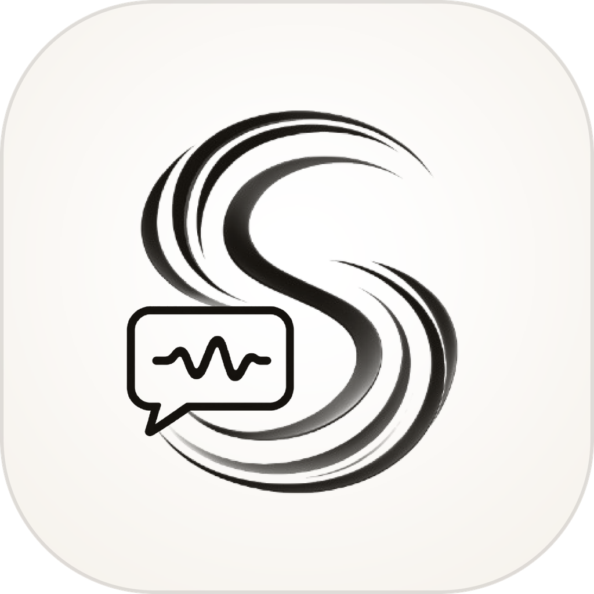<br>
  <sub>Logo © 2026 @3EN2SHG1P (SuiXinWenDa project author) | terms in <a href="NOTICE">NOTICE</a></sub>
</p>

<h1 align="center">SuiXinWenDa · 随心问答</h1>

<p align="center">
  <b>Ask anywhere, anytime — SuiXinWenDa answers.</b><br>
  A desktop AI client that runs on your own machine: streaming chat, per-conversation memory, history, file questions
</p>

<p align="center">
  <a href="LICENSE"></a>
  <a href="https://github.com/3EN2SHG1P/suixinwenda/actions/workflows/ci.yml"></a>
  
  
  
  
  
</p>

<p align="center">
  <a href="README.md">中文</a> ·
  Code MIT · <a href="NOTICE">brand assets</a> all rights reserved ·
  <a href="docs/README.md">Docs index</a> ·
  <a href="PRIVACY.md">Privacy</a> ·
  <a href="SECURITY.md">Security</a> ·
  <a href="SUPPORT.md">Support</a> ·
  <a href="CHANGELOG.md">Changelog</a> ·
  <a href="THIRD-PARTY-NOTICES.md">Third-party notices</a>
</p>

An `Electron` window + a `FastAPI` backend + a local `SQLite` (default) or `MySQL` memory store. The window, the backend
and the database all run on your own machine — **chat history and model keys never leave it**; only your questions go
to the model provider you configure.

**Good fit**: people who want AI Q&A on their own machine without handing chat history to a third-party service, and
anyone looking for a working Electron + FastAPI desktop app to read.

**Bad fit**: anything needing multi-user collaboration, cross-device sync, or public hosting — the backend only binds
to loopback and has no multi-tenancy, rate limiting or HTTPS. **Only the Windows x64 build is provided**; macOS / Linux
need their own electron-builder targets.

---

## Screenshots

<table border="0" cellspacing="0" cellpadding="0">
<tr>
<td width="50%">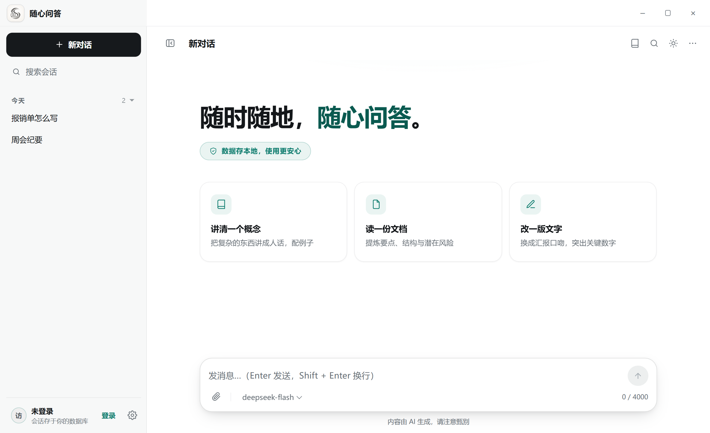<br><sub>First launch: empty state with three task cards</sub></td>
<td width="50%">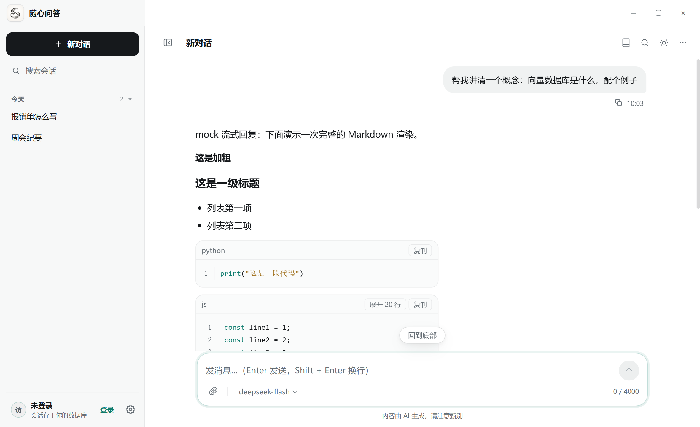<br><sub>Streaming Markdown answer</sub></td>
</tr>
<tr>
<td width="50%">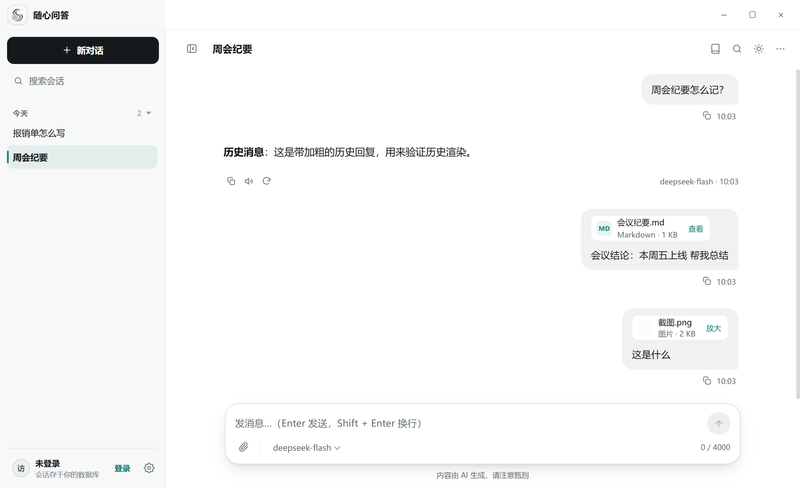<br><sub>History grouped by date</sub></td>
<td width="50%">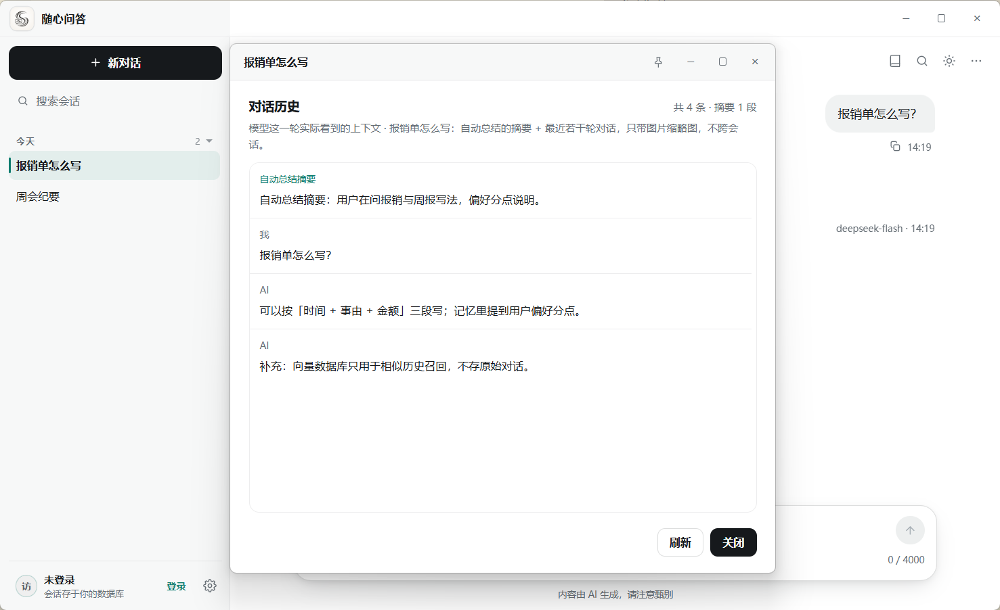<br><sub>What the model actually read this turn</sub></td>
</tr>
<tr>
<td width="50%">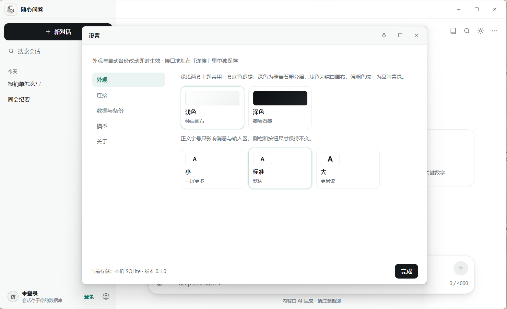<br><sub>Settings in its own window</sub></td>
<td width="50%">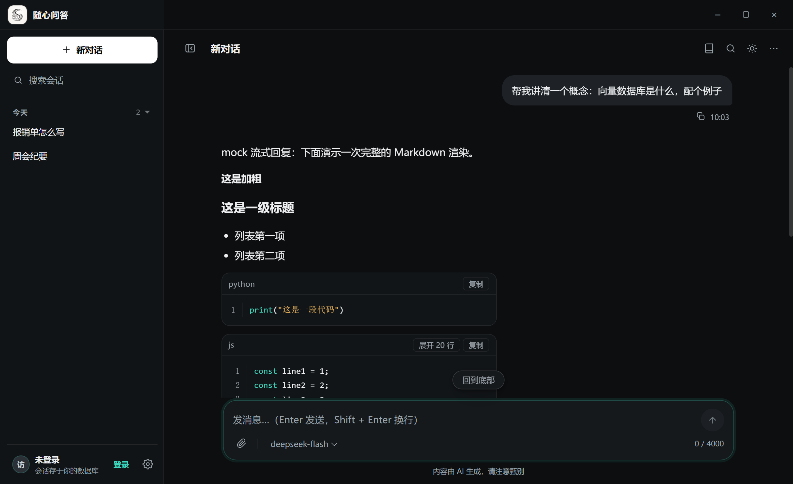<br><sub>Dark theme "Ink Stone"</sub></td>
</tr>
<tr>
<td width="50%">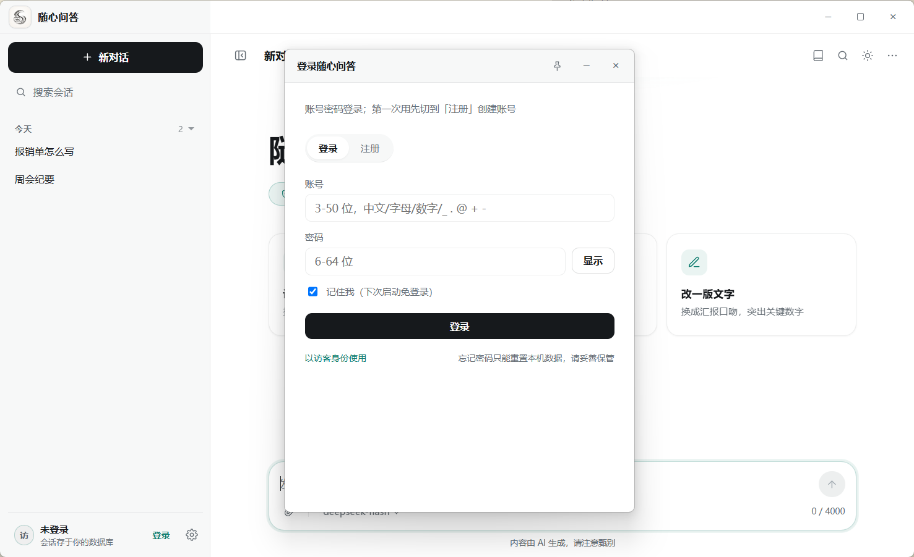<br><sub>Sign in / sign up</sub></td>
<td width="50%">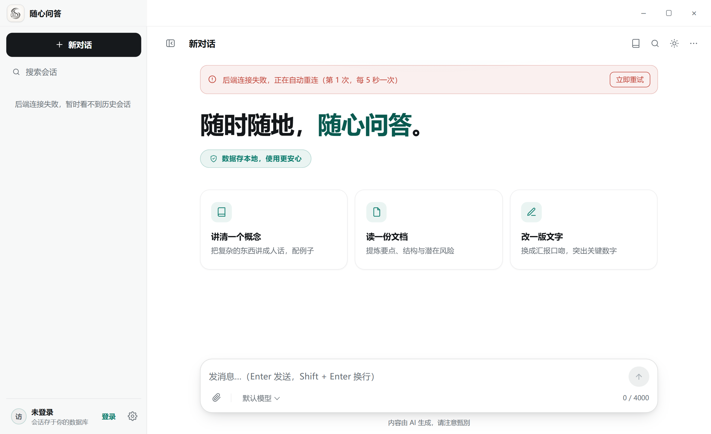<br><sub>Offline banner and retry</sub></td>
</tr>
</table>

Screenshots come from a real local run with demo data — no real user content.

---

## How it fits together

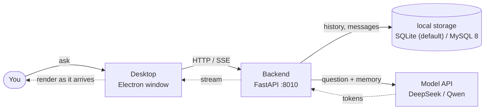

| Process | What runs it | How to reach it |
|---|---|---|
| **8010** | backend `backend/` (binds `127.0.0.1` only) | API docs <http://127.0.0.1:8010/docs>; health <http://127.0.0.1:8010/api/v1/health> |
| **3306** | MySQL 8 (**optional**: container `suixinwenda-mysql` or your own server; SQLite needs no port) | the backend connects to it; no manual table setup |
| **window** | desktop `desktop/` | one Electron window; config lives in `%APPDATA%\suixinwenda-desktop\config.json` |

Context and summaries are maintained by the app itself (`chat_messages` + `chat_summaries`). The old LangGraph
checkpoint tables are retired: existing databases keep them frozen, new installs never create them.

<details>
<summary>Expand: what happens on a single question</summary>

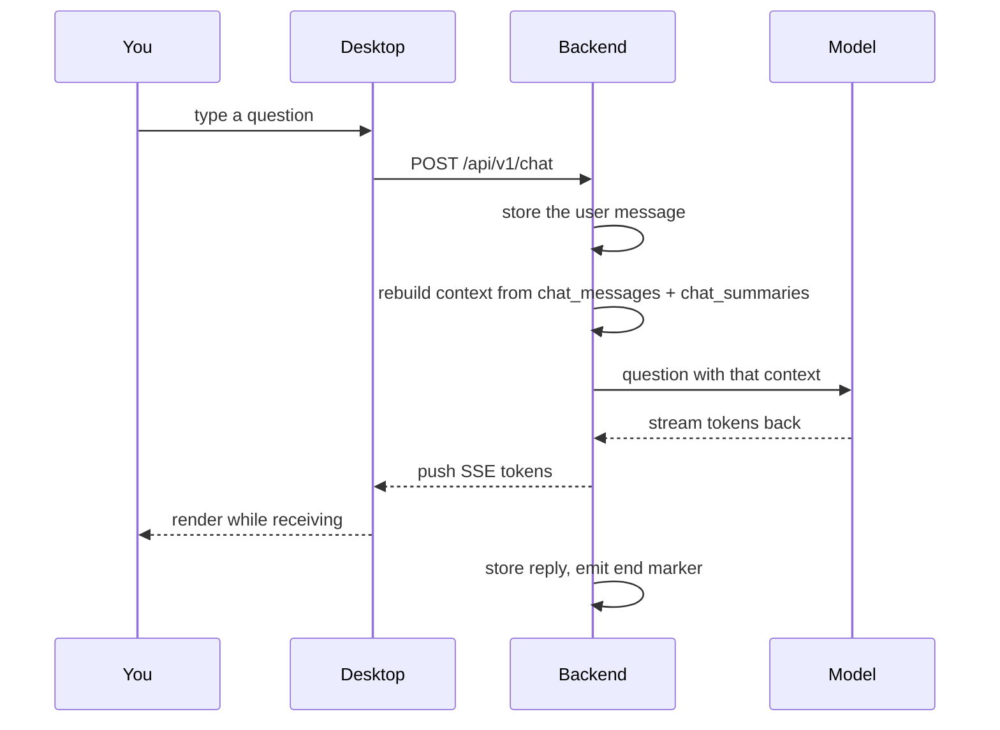

When a conversation grows long, older turns (beyond the last 10 rounds) are compressed into one Chinese summary, so
the context never grows without bound.
</details>

---

## Start in three steps

**Don't want to install Python / Node**: download the installer from
[Releases](https://github.com/3EN2SHG1P/suixinwenda/releases) — `SuiXinWenDa-Setup-<version>.exe` (installer, bundles the
backend) or `SuiXinWenDa-Portable-<version>.exe` (portable, runs from any folder, writes no registry keys). No dev
environment needed.

Neither build is code-signed, so Windows shows "Unknown publisher / Windows protected your PC" on first run — click
"More info → Run anyway". Every release ships a `SHA256SUMS.txt`; verify a download with
`Get-FileHash .\SuiXinWenDa-Setup-<version>.exe -Algorithm SHA256`.

**From source** (to change code or contribute): **All you need** is Python 3.12+, [uv](https://docs.astral.sh/uv/),
Node.js **22+** (`electron@44` needs ≥22.12, `eslint@10` needs ≥22.13). Avoid non-ASCII characters and spaces in the
project path.

```powershell
git clone https://github.com/3EN2SHG1P/suixinwenda.git suixinwenda
cd suixinwenda
.\start.ps1
```

The first launch shows a small splash window with the real startup stage; the main window appears only once the
backend is already healthy, so you never see a "connection failed" flash. If PowerShell blocks the script:

```powershell
powershell -ExecutionPolicy Bypass -File .\start.ps1
```

Useful switches: `-DryRun` runs every check and exits without opening the window; `-SkipDocker` never starts a
container (use an existing MySQL); `-NonInteractive` never waits for keyboard input (for scripts and scheduled
tasks). Every run writes `start.log` into the repo root — it records each stage and the exit code, so start there
when something fails. The script also prints the stage it stopped at and a matching exit code (1 environment,
2 config, 3 database, 4 dependencies, 5 startup).

Storage needs **nothing installed**: SQLite (`backend/data/suixinwenda.db`) is created on first start.
MySQL 8 is optional — either the bundled `docker-compose.yml` or your own server.

<details>
<summary>Expand: manual steps (two terminals)</summary>

```powershell
# 1) config: create backend/.env from the template
#    (skip this when using start.ps1 — it copies the template and generates JWT_SECRET for you)
copy backend\.env.example backend\.env
python -c "import secrets;print(secrets.token_urlsafe(48))"   # put the output into JWT_SECRET=

# 2) database: skip for SQLite; only for MySQL
docker compose up -d          # or use your own MySQL and edit DB_* in .env

# 3) backend (first terminal)
cd backend
uv sync
uv run python -m uvicorn main:app --host 127.0.0.1 --port 8010

# 4) desktop (second terminal)
cd desktop
npm ci
npm start
```

- If something already listens on 3306, **do not** run `docker compose up -d` (`port is already allocated`) — use that server instead.
- With your own MySQL: create an empty `utf8mb4` database first (default `suixinwenda`); tables are created automatically.
- To force skipping the container: `.\start.ps1 -SkipDocker`.

</details>

### Add a model

Models are configured **inside the app**, one key per model — any OpenAI-compatible endpoint works.
Settings → Models → Add model: fill Base URL, API key and model ID (e.g. `https://api.deepseek.com/v1` + `deepseek-chat`).
Saving restarts the backend and verifies the key once; a bad key shows a concrete reason and the old config stays active.
Keys are encrypted at rest (`models.json`, DPAPI on Windows) and never shown again in the UI.

### How to tell it worked

| Check | Expected |
|---|---|
| Backend | <http://127.0.0.1:8010/docs> lists the API; `/api/v1/health` returns `code: 0` |
| Window | the app opens, no blank page, no offline banner |
| Chat | with a model configured, answers stream in; asking "what did I just ask?" proves memory works |

Anonymous chat works without an account; signing in claims those local conversations.
Registration only needs a username and password (no phone or email): username 3–50 characters, password 6–64, so
**a lost password cannot be recovered**.

---

## What it does

| Capability | Detail |
|---|---|
| Streaming chat | token-by-token rendering of Markdown, code blocks, tables and task lists; stop and regenerate mid-stream |
| Per-conversation memory | independent context per conversation, compressed into a summary when it grows long — never shared across conversations or devices |
| History | grouped by today / yesterday / last 7 days / older; search, rename, delete, export to Markdown |
| File questions | images, PDF, Word, Excel, txt by picker, drag-and-drop or paste; up to 9 files, 10 MB each, 30 MB total |
| Local storage | SQLite by default, MySQL 8 optional; backup / export / restore / purge from the settings window |
| Multiple models | any OpenAI-compatible endpoint, one key per model, verifiable in the UI |
| Desktop experience | light/dark themes, three font sizes, separate child windows (settings / history / models / prompt library), offline auto-reconnect, menu shortcuts |
| Prompt library | open it from the "more" menu: keep prompt templates locally, search, copy to clipboard, delete; stored in local `localStorage` only |

Button-level walkthroughs live in **[docs/使用手册.md](docs/使用手册.md)** (Chinese); environment variables, the API
list and backup semantics live in **[docs/配置与接口.md](docs/配置与接口.md)** (Chinese).

---

## Troubleshooting

Most failures come from three things: **no `.env`**, **database unreachable**, **key added without restarting the backend**.

| Symptom | Fix |
|---|---|
| `JWT_SECRET` missing | run `start.ps1` (it generates one) or add a random 32+ character secret yourself |
| `Can't connect to MySQL server` / `Access denied` / `Unknown database` | start the bundled database with `docker compose up -d`, or fix `DB_*` for your own server |
| Empty model list / `invalid API key` | restart the backend after editing config; Settings → Models → Verify shows the concrete reason |
| Offline banner never goes away | backend not running or wrong port; use "retry" on the banner or Settings → Connection → Test |
| `start.ps1` fails with `NativeCommandError` / stops at "检查环境" | the current script no longer aborts when Docker is down; if it still fails, read `start.log` in the repo root — it records the failing stage and the exit code |

A fuller troubleshooting guide (startup, SSE, database, desktop, packaging) is in
**[docs/踩坑与FAQ.md](docs/踩坑与FAQ.md)** (Chinese).

---

## Known limitations

This is a single-user, local-only desktop client. It is **not production-ready**.

| Limitation | Detail |
|---|---|
| Single user, local only | backend binds `127.0.0.1`; no HTTPS, no rate limiting, no multi-tenancy — **do not expose it to the internet** |
| Demo verification codes | the sign-in / sign-up UI no longer offers a code field; the `/send_code` and `/login_by_code` endpoints remain and do **not** echo the code by default (it is only written to the server log). Set `DEMO_CODE_MODE=1` only for a local demo |
| Anonymous sessions are not isolated | all anonymous conversations on one machine share one identity, so co-workers would see each other's chats |
| Password & token | PBKDF2-HMAC-SHA256 (600k iterations, random salt) + hand-rolled HS256 JWT — fine locally; use argon2id and a maintained auth library in production |
| One store at a time | SQLite or MySQL 8; switching does not migrate data, the two stores stay independent |
| Questions only | no web search, no tool calling, no acting on external systems |
| Windows x64 only | macOS / Linux need their own electron-builder targets |
| Key storage | the desktop app uses OS encryption (DPAPI on Windows); the decrypted copy exists only briefly under `userData/runtime/` and is deleted on exit |

---

## Documentation

The detailed docs are written in Chinese; pull requests adding English translations are welcome.
The README below is fully translated, and every command in it works as-is.

| I want to… | Read |
|---|---|
| Find which doc covers something | [docs/README.md](docs/README.md) (doc index) |
| Learn every button | [docs/使用手册.md](docs/使用手册.md) |
| Look up env vars, API list, SSE format | [docs/配置与接口.md](docs/配置与接口.md) |
| Debug a specific error | [docs/踩坑与FAQ.md](docs/踩坑与FAQ.md) |
| Run tests, build an installer, clean up uninstall leftovers | [docs/打包与发布.md](docs/打包与发布.md) |
| Change the UI | [docs/dev/页面设计规范.md](docs/dev/页面设计规范.md) |
| Cut a release | [docs/dev/发布流程.md](docs/dev/发布流程.md) |
| Know where data lives and who sees it | [PRIVACY.md](PRIVACY.md) |
| Report a vulnerability | [SECURITY.md](SECURITY.md) |
| Contribute | [CONTRIBUTING.md](CONTRIBUTING.md) |
| Read the code of conduct | [CODE_OF_CONDUCT.md](CODE_OF_CONDUCT.md) |
| See what changed | [CHANGELOG.md](CHANGELOG.md) |
| Check whether I may use the logo or the name | [NOTICE](NOTICE) |
| See third-party component licenses | [THIRD-PARTY-NOTICES.md](THIRD-PARTY-NOTICES.md) |

---

## License

Code is released under the [MIT License](LICENSE). The logo, the names "随心问答" / "SuiXinWenDa", the brand marks and
the UI screenshots are brand assets, **all rights reserved**, and **not covered by the MIT license**. Allowed:
redistribution together with the source or the official installer, in-app display, and quoting in tutorials, videos or
reviews with attribution. Not allowed: commercial use, using them as another project's identity, registering them as a
trademark or trade name, or altering the artwork itself. Full terms in [NOTICE](NOTICE); the permission is irrevocable
for released versions.

### Before exposing it to a network

This project is designed for single-user, local use. If you must serve it to others, do at least these four things:

- **Rotate the secret**: generate a new `JWT_SECRET`; do not keep the one generated on first run
- **Keep echoing off**: `DEMO_CODE_MODE=0` (the default), and leave `MOCK_CODE` empty; if you enabled it for a demo, turn it back off
- **Replace auth**: swap PBKDF2 + hand-rolled JWT for argon2id + a maintained auth library, and add HTTPS and rate limiting
- **Tighten access**: bind the backend and the origin allow-list to your real domain; never leave it on `0.0.0.0`

Third-party services: model providers (DeepSeek, Alibaba Cloud Bailian) require your own API key and are billed by
them; this project is **not affiliated with them** and is not an official client.
Third-party components follow their own licenses — see [THIRD-PARTY-NOTICES.md](THIRD-PARTY-NOTICES.md).
