<p align="center">
  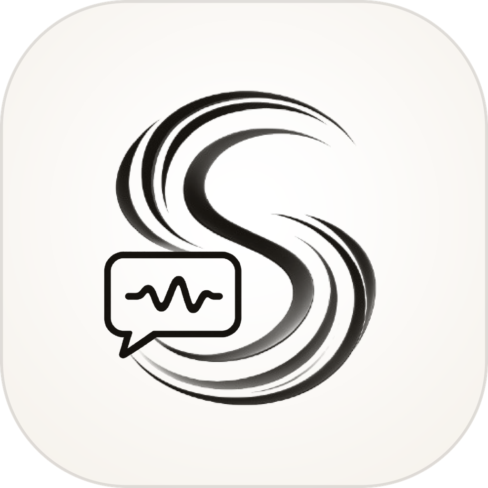<br>
  <sub>Logo © 2026 @3EN2SHG1P（随心问答项目作者） ｜ 使用范围见 <a href="./NOTICE">NOTICE</a></sub>
</p>

<h1 align="center">随心问答 · SuiXinWenDa</h1>

<p align="center"><b>随时随地，随心问答</b><br/>本机运行的桌面 AI 客户端：流式对话、跨轮记忆、历史会话、文件提问</p>

<p align="center">
  <a href="LICENSE"></a>
  <a href="https://github.com/3EN2SHG1P/suixinwenda/actions/workflows/ci.yml"></a>
  
  
  
  
  
</p>

`Electron` 桌面窗口 + `FastAPI` 后端 + 本机 `SQLite`（默认）或 `MySQL` 记忆库。窗口、后端、数据库都跑在你自己电脑上，**聊天记录和模型 Key 不出本机**，只有提问内容会发给你自己配置的模型服务。

**文档**：[文档索引](./docs/README.md) ｜ [使用手册](./docs/使用手册.md) ｜ [配置与接口](./docs/配置与接口.md) ｜ [踩坑与 FAQ](./docs/踩坑与FAQ.md) ｜ [打包与发布](./docs/打包与发布.md) ｜ [贡献指南](./CONTRIBUTING.md) ｜ [隐私](./PRIVACY.md) ｜ [安全](./SECURITY.md) ｜ [English](./README.en.md)

**适合**：想在自己电脑上用 AI 问答、又不愿把聊天记录交给第三方服务的人；以及想读一份能跑通的 Electron + FastAPI 桌面应用的人。

**不适合**：需要多人协作、多设备同步，或要对外提供服务的场景——后端只监听本机回环，没有多租户、限流与 HTTPS。**目前只提供 Windows x64 安装包**，macOS / Linux 需自行补 electron-builder 配置。

---

### 界面预览

<table border="0" cellspacing="0" cellpadding="0">
<tr>
<td width="50%" style="padding:0 8px 18px 0">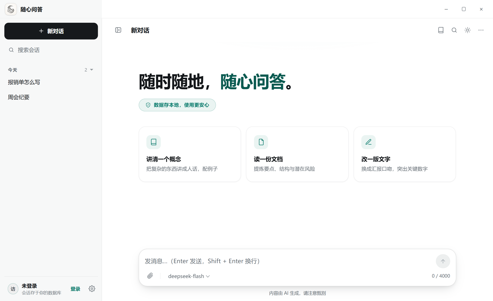<sub>欢迎页：空态 + 三张任务卡</sub></td>
<td width="50%" style="padding:0 8px 18px 0">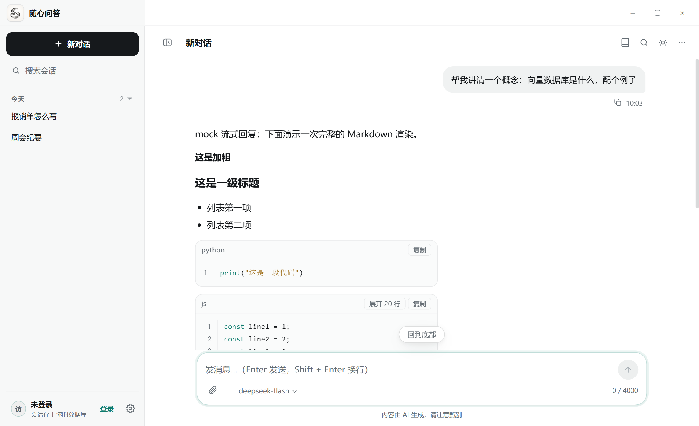<sub>流式对话：Markdown / 代码块 / 表格逐字渲染</sub></td>
</tr>
<tr>
<td width="50%" style="padding:0 8px 18px 0">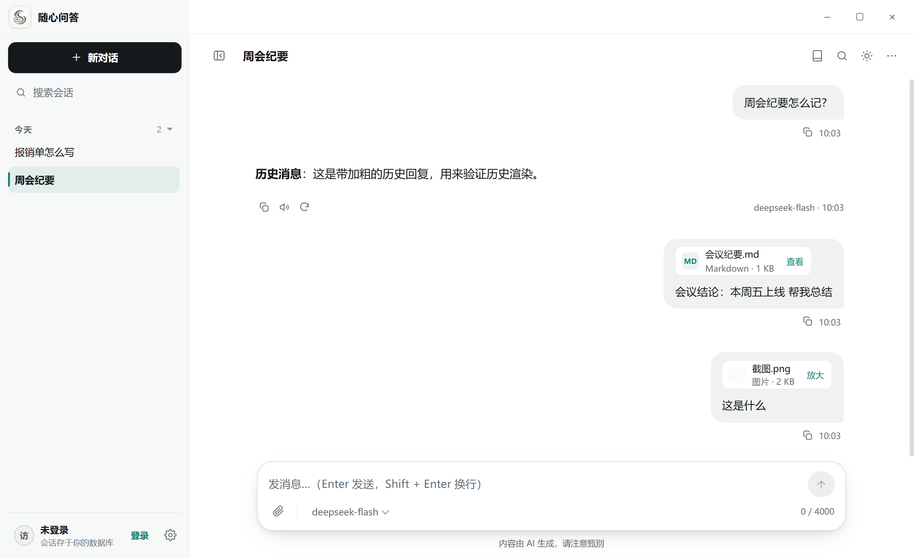<sub>历史会话：按时间分组</sub></td>
<td width="50%" style="padding:0 8px 18px 0">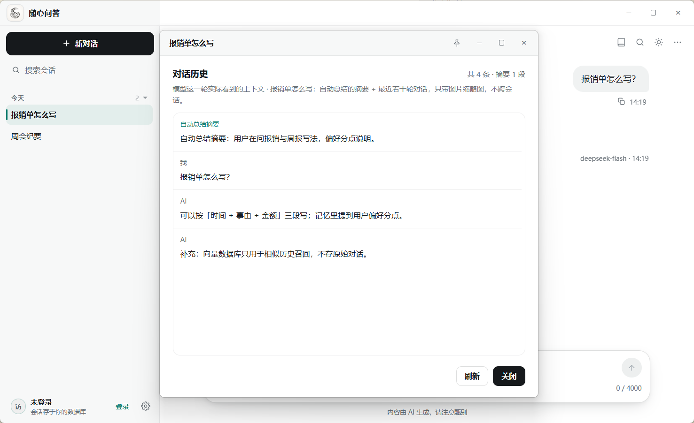<sub>对话历史：看模型这一轮读到了什么</sub></td>
</tr>
<tr>
<td width="50%" style="padding:0 8px 18px 0">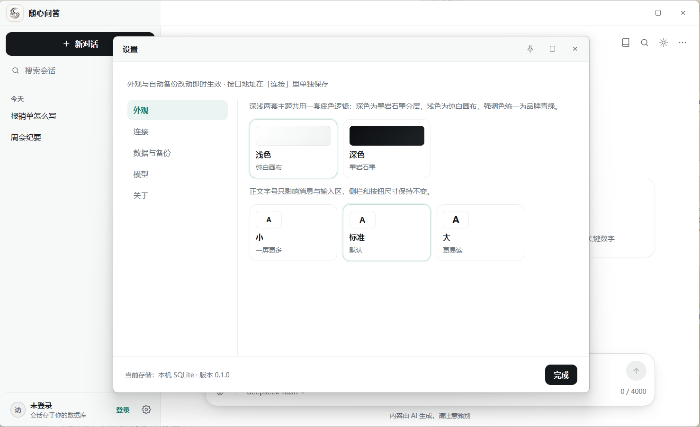<sub>设置：外观 / 连接 / 数据与备份 / 模型 / 关于</sub></td>
<td width="50%" style="padding:0 8px 18px 0">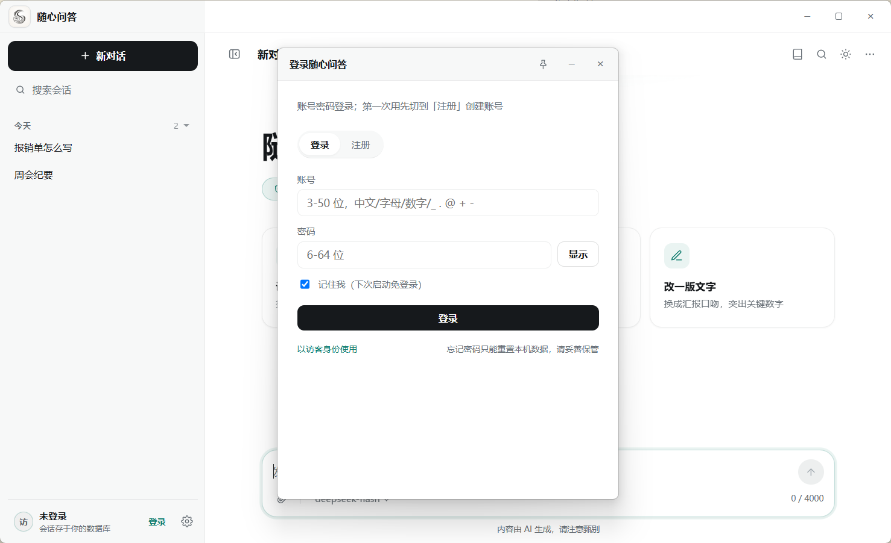<sub>登录 / 注册，也能以访客身份使用</sub></td>
</tr>
<tr>
<td width="50%" style="padding:0 8px 18px 0">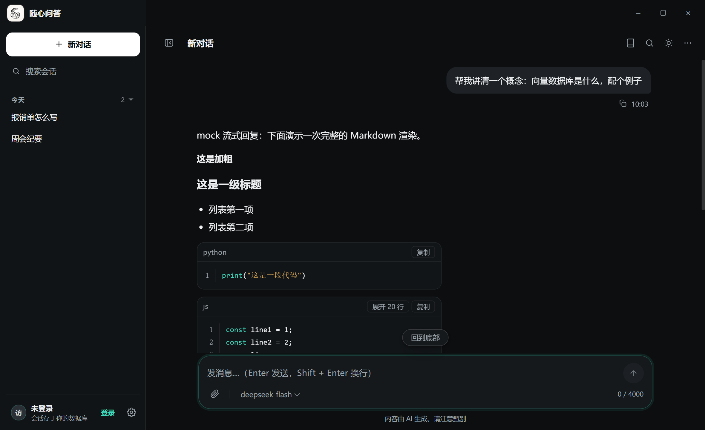<sub>深色「墨岩」主题</sub></td>
<td width="50%" style="padding:0 8px 18px 0">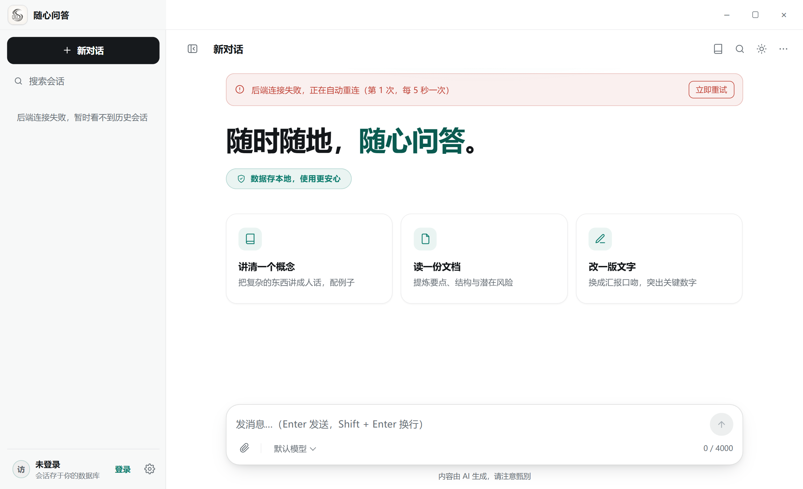<sub>后端没起：离线横幅 + 自动重连</sub></td>
</tr>
</table>

截图均来自本地真实运行，会话内容由演示数据生成，不含任何真实用户数据。

---

## 1. 长什么样

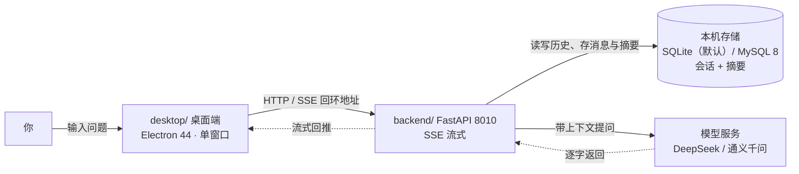

上下文与摘要由应用自己维护（`chat_messages` + `chat_summaries` 两张表）；LangGraph 的 checkpoint 表已停用，历史库里的旧表冻结保留，新装环境不再创建。

| 进程 | 谁在跑 | 怎么访问 |
|---|---|---|
| **8010** | 后端 `backend/`（只监听 `127.0.0.1`） | 接口文档 <http://127.0.0.1:8010/docs>；健康检查 <http://127.0.0.1:8010/api/v1/health> |
| **3306** | MySQL 8（**可选**：容器 `suixinwenda-mysql` 或你本机的库；默认走 SQLite，不占端口） | 后端独占连接，不需要手工建表 |
| **窗口** | 桌面端 `desktop/` | Electron 单窗口，配置存 `%APPDATA%\suixinwenda-desktop\config.json` |

<details>
<summary>一次提问实际经过了什么</summary>

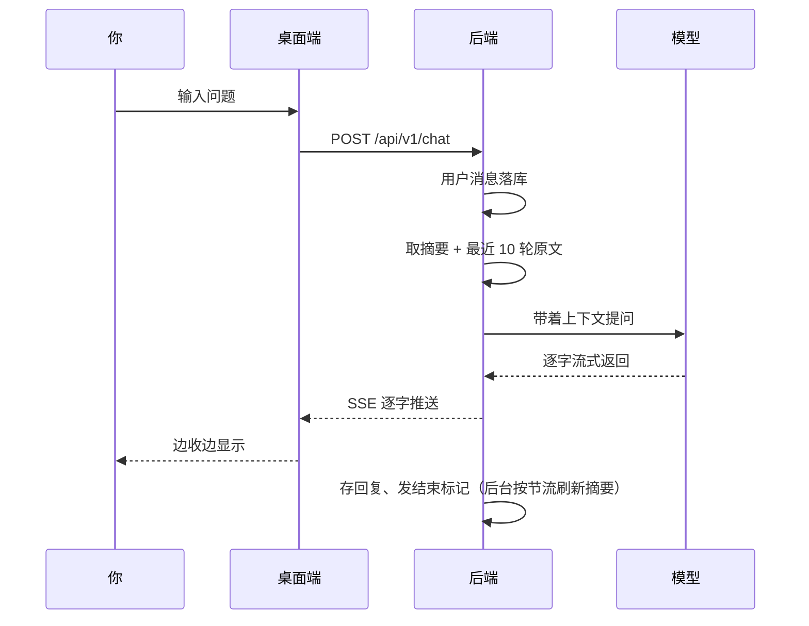

聊得太长时，保留窗口之外（默认 10 轮）的旧对话会被压成一段中文摘要落库，下次只带摘要 + 最近 10 轮，上下文不会无限膨胀。

</details>

---

## 2. 三步跑起来

**不想装 Python / Node**：从 [Releases](https://github.com/3EN2SHG1P/suixinwenda/releases) 下载安装包——
`SuiXinWenDa-Setup-<版本>.exe`（安装版，自带后端）或 `SuiXinWenDa-Portable-<版本>.exe`（免安装，可放任意目录，不写注册表）。
安装版不需要本机有任何开发环境，装完直接打开。

两个包都**没有代码签名**，首次运行 Windows 会提示「未知发布者 / 已保护你的电脑」，点「更多信息 → 仍要运行」即可。
每个 Release 同时附 `SHA256SUMS.txt`，可用 `Get-FileHash .\SuiXinWenDa-Setup-<版本>.exe -Algorithm SHA256` 核对下载到的文件是否原版。

**从源码跑**（想改代码或参与开发）：前置 **Python 3.12+**、**[uv](https://docs.astral.sh/uv/)**、**Node.js 22+**（`electron@44` 要求 ≥22.12，`eslint@10` 要求 ≥22.13）。项目路径不要带中文和空格。

**拿代码**：

```powershell
git clone https://github.com/3EN2SHG1P/suixinwenda.git
cd suixinwenda
```

**起服务**：双击图标或跑一条脚本都可以，后端由桌面端托管（关窗口时一并收掉）：

```powershell
.\start.ps1
```

首次打开会显示一个启动小窗（logo + 真实启动阶段 + 细进度线），主窗口出现时后端已经就绪，不会先闪一段「连接失败」。
被 PowerShell 拦下时改用 `powershell -ExecutionPolicy Bypass -File .\start.ps1`；已装好 MySQL 想跳过 Docker 加 `-SkipDocker`。
只想检查环境、不打开窗口：`.\start.ps1 -DryRun`；给脚本或计划任务调用时加 `-NonInteractive`（不等待任何键盘输入）。
脚本每次运行都会把过程写进仓库根目录的 `start.log`，起不来时先看这个文件。

**加模型**：窗口里打开 设置 → 模型 → 添加模型，填 Base URL、API Key、模型 ID（例如 DeepSeek：`https://api.deepseek.com/v1` + `deepseek-chat`），
保存后本地服务自动重启并立刻做一次验证。不填也能开窗口看到完整界面，只是模型下拉里没有模型。

数据库**不需要安装任何东西**：默认用本机 SQLite（`backend/data/suixinwenda.db`，首次启动自动建）。
想用 MySQL 8 再按下面「① 准备数据库」配 `.env`，也可以装 Docker 用仓库自带的 `docker-compose.yml`。

<details>
<summary>手动五步（两个终端）</summary>

| 步 | 做什么 | 跑对了是什么样 |
|---|---|---|
| ① | （可跳过）起数据库 | 默认 SQLite 什么都不用装；只有要用 MySQL 才看 `docker compose ps` 是否为 `healthy` |
| ② | 进 `backend/`，`uv sync` | 出现 `Installed ... packages`，多出 `.venv` |
| ③ | 复制 `.env`，填 `JWT_SECRET` | 该行不为空（至少 32 位） |
| ④ | `uv run python -m uvicorn main:app --port 8010` | `Uvicorn running on http://127.0.0.1:8010` |
| ⑤ | 另一个终端进 `desktop/`，`npm ci` → `npm start` | Electron 窗口弹出 |

④⑤ 两个窗口都是长驻进程，**不能关**。

**① 准备数据库**：默认 SQLite 可整步跳过。要用 MySQL 时二选一——

- **Docker**：根目录 `docker compose up -d`，等 `docker compose ps` 显示 `healthy`。容器 `suixinwenda-mysql` 只绑 `127.0.0.1:3306`，`.env` 默认值与它一致。
- **本机已有 MySQL**：**不要**再执行 `docker compose up -d`（会报 `port is already allocated`）；先建空库
  `CREATE DATABASE suixinwenda DEFAULT CHARACTER SET utf8mb4;`，再把 `.env` 的 `DB_USER` / `DB_PASSWORD` / `DB_HOST` / `DB_PORT` 改成你自己那份。

**② 装依赖**：`cd backend` → `uv sync`（没装 uv 先 `pip install uv`，装完重开终端）。

**③ 填配置**：`copy .env.example .env`，用
`python -c "import secrets;print(secrets.token_urlsafe(48))"` 生成密钥填进 `JWT_SECRET`。
留空会直接报「缺少配置项：JWT_SECRET」；用 `start.ps1` 可跳过这步，脚本会自动生成。

**④ 起后端**：`cd backend` → `uv run python -m uvicorn main:app --host 127.0.0.1 --port 8010`。
首次启动自动建表，不需要手工执行任何 SQL。

**⑤ 起桌面端**：`cd desktop` → `npm ci` → `npm start`。装依赖卡在 Electron 下载时先换源：
`npm config set registry https://registry.npmmirror.com`。

</details>

### 看到什么算成功

- 接口活着：<http://127.0.0.1:8010/docs> 能看到可交互文档，`/api/v1/health` 返回 `code: 0`
- 窗口正常：出现「随心问答」窗口，不白屏，输入框能打字、消息区不显示离线横幅
- 走一轮对话：提问 → 回答逐字冒出来 → 再问「我刚才问了什么」能答上来（记忆生效）

登录规则：**不登录也能聊**（匿名会话记在本机），登录后自动认领之前的匿名会话。
注册只要账号 + 密码，不需要手机号 / 邮箱，因此**密码丢了找不回**；账号 3–50 位，密码 6–64 位。

---

## 3. 能做什么

| 能力 | 说明 |
|---|---|
| 流式对话 | 逐字返回，Markdown / 代码块 / 表格 / 待办按块增量渲染，可中途停止与重新生成 |
| 跨轮记忆 | 每个会话独立上下文，超长时自动压成中文摘要，不跨会话、不跨设备 |
| 历史会话 | 按今天 / 昨天 / 过去 7 天 / 更早分组，支持搜索、重命名、删除、导出 Markdown |
| 文件提问 | 图片 / PDF / Word / Excel / txt，点选、拖拽或粘贴，一次最多 9 个，单个 10 MB、合计 30 MB |
| 本机存储 | 默认 SQLite 零安装，可切 MySQL；备份 / 导出 / 恢复 / 一键清除都在设置里 |
| 多模型 | 兼容任何 OpenAI 协议接口，每个模型自带 Key，界面可验证、可切换 |
| 桌面体验 | 深浅主题、三档字号、独立子窗口（设置 / 历史 / 模型 / 提示词库等）、离线自动重连、菜单快捷键 |
| 提示词库 | 「更多」菜单打开：本机保存常用提问模板，支持搜索、一键复制到剪贴板、删除；只存在本机 `localStorage` |

按钮级操作、每个设置项怎么点，见 **[docs/使用手册.md](./docs/使用手册.md)**；环境变量、接口清单、备份恢复的技术口径见 **[docs/配置与接口.md](./docs/配置与接口.md)**。

---

## 4. 跑不起来怎么办

绝大多数问题出在三件事上：**`.env` 没建**、**数据库连不上**、**Key 没重启后端**。

| 症状 | 处理 |
|---|---|
| 报「缺少配置项：JWT_SECRET」 | 跑 `start.ps1` 自动生成，或手动生成一串填进 `.env` |
| 报 `Can't connect to MySQL server` / `Access denied` / `Unknown database` | 数据库没起或账号口令不对：`docker compose up -d` 起自带的库，或按本机 MySQL 改 `.env` |
| 模型下拉为空 / 报 `API Key 无效` | 改完配置必须重启后端；到 设置 → 模型 点「验证」看具体原因 |
| 一直显示离线横幅 | 后端没起或端口不对：点横幅上的「立即重试」，或到设置 → 连接改地址后点「检测连接」 |
| `start.ps1` 报 `NativeCommandError` / 停在「检查环境」 | 新版脚本不会再出现（Docker 未启动不再中断）；仍有异常时看仓库根目录 `start.log`，里面逐阶段记录了失败点与退出码 |

完整排错（启动、SSE、数据库、桌面端、打包五类，逐条给现象 / 根因 / 处理）见 **[docs/踩坑与FAQ.md](./docs/踩坑与FAQ.md)**。

---

## 5. 已知限制

定位是本机单人用的桌面客户端，以下为明确边界，不影响本地跑通，但**不具备生产可用性**。

| 限制 | 说明 |
|---|---|
| 只给本机单人用 | 后端只监听 `127.0.0.1`，无 HTTPS、无限流、无多租户，**不要直接部署到公网** |
| 验证码是演示的 | 注册 / 登录界面已不提供验证码入口，接口 `/send_code`、`/login_by_code` 仍保留；**默认不回显验证码**（只写服务端日志），做演示时置 `DEMO_CODE_MODE=1` 才会回显 |
| 匿名会话不隔离 | 同一台机器上不登录产生的会话属于同一个「匿名身份」，多人共用会互相可见 |
| 密码与令牌 | PBKDF2-HMAC-SHA256（60 万次迭代 + 随机盐）+ 手写 HS256 JWT，够本机用；生产请换 argon2id + 成熟鉴权库 |
| 存储二选一 | 默认本机 SQLite，可切 MySQL 8；两种库互相独立，切换不搬运数据 |
| 只做问答 | 不联网搜索、不调工具、不代你操作任何外部系统 |
| 只打了 Windows x64 | macOS / Linux 需自行补 electron-builder 配置 |
| 密钥存储 | 桌面端用系统能力（Windows DPAPI）加密保存模型 Key；运行期解出的明文只在 `userData/runtime/` 下短暂存在，退出即删 |

---

## 6. 文档地图

| 我想…… | 看这里 |
|---|---|
| 不知道某件事该看哪份文档 | [docs/README.md](./docs/README.md)（文档总索引） |
| 学会每个按钮怎么点 | [docs/使用手册.md](./docs/使用手册.md) |
| 查环境变量、接口清单、SSE 格式 | [docs/配置与接口.md](./docs/配置与接口.md) |
| 排查具体报错、看踩过的坑 | [docs/踩坑与FAQ.md](./docs/踩坑与FAQ.md) |
| 跑测试、打安装包、处理卸载残留 | [docs/打包与发布.md](./docs/打包与发布.md) |
| 改界面前读设计规范 | [docs/dev/页面设计规范.md](./docs/dev/页面设计规范.md) |
| 把一个版本发到 Releases | [docs/dev/发布流程.md](./docs/dev/发布流程.md) |
| 了解数据存在哪、怎么被使用 | [PRIVACY.md](./PRIVACY.md) |
| 报告安全问题 | [SECURITY.md](./SECURITY.md) |
| 提问 / 找人帮忙 | [SUPPORT.md](./SUPPORT.md) |
| 参与贡献 | [CONTRIBUTING.md](./CONTRIBUTING.md) |
| 看行为准则 | [CODE_OF_CONDUCT.md](./CODE_OF_CONDUCT.md) |
| 看版本变更 | [CHANGELOG.md](./CHANGELOG.md) |
| 看第三方依赖许可 | [THIRD-PARTY-NOTICES.md](./THIRD-PARTY-NOTICES.md) |
| 想知道 logo 与品牌名能不能用 | [NOTICE](./NOTICE) |
| English | [README.en.md](./README.en.md) |

```
suixinwenda/
├── backend/                # FastAPI 服务（8010，仅本机回环）
│   ├── core/               # config / db_info / database / ai / chat / context / summary / history / attachments / files / security / user / backup / limits / migrations / models_config / errors
│   ├── routers/            # health / user / chat / conversations / attachments（含 deps、common）
│   ├── models/             # 表结构与 ORM
│   ├── schemas/            # 请求 / 响应模型
│   ├── tools/              # 备份 / 导出 / 恢复 / 清除 / 存储自检 / 附件目录迁移 / 存储诊断（db_info）
│   ├── tests/              # pytest（临时目录 SQLite，不需要数据库服务）
│   ├── main.py             # 应用入口：挂路由、启动建表、异常兜底
│   ├── pyproject.toml      # 依赖与 uv 配置
│   └── .env.example        # 环境变量模板（真实 .env 不入库）
├── desktop/                # Electron 桌面端
│   ├── src/                # 主进程 / preload / app-windows / renderer（app.js、index.html、styles.css、views、assets）
│   ├── tools/              # 打包 / 假后端 / 冒烟 / 后端打包 / 产物自检 / 版本同步 / 图标生成 / 许可全文生成 / 全局声明检查
│   └── package.json        # 依赖与 electron-builder 配置
├── docs/                   # 文档索引 / 使用手册 / 配置与接口 / 踩坑与FAQ / 打包与发布 / screenshots
│   └── dev/                # 开发者文档：页面设计规范 / 发布流程
├── docker-compose.yml      # 一键起 MySQL 8（容器 suixinwenda-mysql）
├── start.ps1               # Windows 一键启动：环境 → 配置 → 依赖 → 存储 → 端口 → 窗口（后端由桌面端托管）
└── README.md / README.en.md / PRIVACY.md / SECURITY.md / CONTRIBUTING.md / CHANGELOG.md / CODE_OF_CONDUCT.md / THIRD-PARTY-NOTICES.md / NOTICE / LICENSE
```

---

## 声明

代码按 [MIT License](./LICENSE) 发布。logo、「随心问答」/「SuiXinWenDa」名称与品牌标识、界面截图属于品牌素材，**保留所有权利**，不在 MIT 许可范围内：允许随源码或官方安装包再分发、部署展示、在教程与评测中引用（注明来源）；禁止商用、用作其他项目的标识、注册为商标、改动图形本身。完整条款见 [NOTICE](./NOTICE)，该许可对已发布版本不可撤回。

**部署提醒**：本项目定位为本机单人使用。若要对外提供访问，至少先完成四件事。

- **换密钥**：用 `python -c "import secrets;print(secrets.token_urlsafe(48))"` 重新生成本机 `JWT_SECRET`，不要沿用任何示例值（长度不足 32 位后端会拒绝启动）
- **确认回显已关**：默认就是 `DEMO_CODE_MODE=0`；如果你为演示打开过，务必改回 0 并把 `MOCK_CODE` 置空
- **换鉴权**：PBKDF2 + 手写 JWT 换成 argon2id + 成熟库，补 HTTPS 与限流
- **收敛访问**：后端绑定与来源白名单按你的实际域名重配，别裸奔在 `0.0.0.0`

### 第三方服务声明

- 模型服务（DeepSeek、阿里云百炼）需自备 API Key、费用自负，并遵守各自服务条款
- 本项目**与这些公司无任何关联**，也不是它们的官方客户端；界面里的模型名称仅用于指明调用的服务
- 第三方依赖各自遵循其原始许可，清单见 [THIRD-PARTY-NOTICES.md](./THIRD-PARTY-NOTICES.md)
