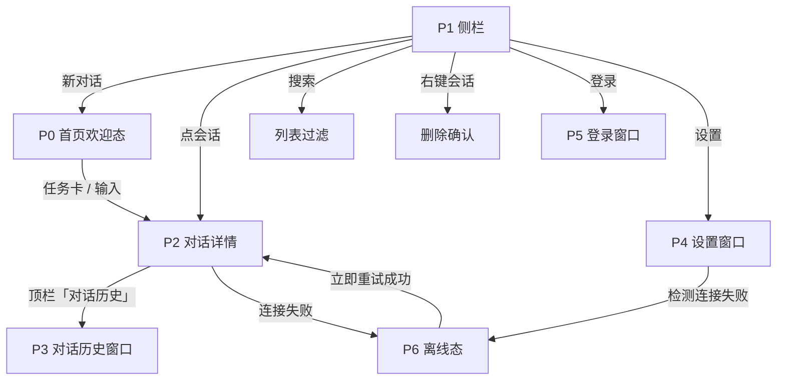

# 页面设计规范

> 文档索引：[docs/README.md](../README.md) ｜ 开发者文档：[dev/README.md](./README.md)

「随心问答」桌面端的界面规范：页面版块结构、设计 Token、组件复用、响应式与交互动效。
配色：**深色 = 墨岩石墨分层 + 品牌青绿**，**浅色 = 纯白画布 + 同一支青绿**。落地细节见第 4.1 节的 Token 表（唯一出处是 `styles.css`）。

- 视觉唯一出处：`desktop/src/renderer/styles.css` 的 `:root`（浅色）与 `[data-theme='dark']`（深色）
- 结构唯一出处：`desktop/src/renderer/index.html`；元素 id 被 `renderer/app.js` 直接引用，改 id 必须同步改 JS

---

## 1. 设计原则

1. **内容优先**：阅读区是主角，工具按「跟当前对象有关」归位，输入坞只留输入相关的东西。
2. **一支强调色**：全站只有一个品牌青绿，面积受控；状态色只表达状态，不做装饰。
3. **窗口而非遮罩**：需要额外空间就开真正的子窗口（可拖动、可缩放、位置记忆），主窗口里不叠遮罩。
4. **状态即类名**：颜色、间距、圆角、动效全部走 Token，组件里不写死值；状态用 `.is-*` 修饰。
5. **零构建**：原生 HTML / CSS / JS，改完刷新即生效，不引入框架与打包步骤。

---

## 2. 页面清单与导航

主窗口 + 独立子窗口，无路由：主区状态表达聊天，所有「窗口」都独立成真正的子窗口（规则见 4.6）：

| 编号 | 页面 / 状态 | 形态 | 一句话职责 |
|---|---|---|---|
| P0 | 首页（欢迎态） | 主窗口 | 让人 3 秒内发出第一句 |
| P1 | 会话列表（侧栏） | 主窗口 | 找到、切换、删除历史会话 |
| P2 | 对话详情（主区） | 主窗口 | 读完回答并继续追问 |
| P3 | 对话历史 | 独立窗口 640×620 | 知道模型这一轮看到了什么 |
| P4 | 设置 | 独立窗口 800×600 | 改后端地址、切主题、看版本 |
| P5 | 登录 / 注册 | 独立窗口 448 宽 | 账号 + 密码进入，注册即登录 |
| P6 | 离线态（横幅 + 占位） | 后端没起时不当死页 |
| P7 | 空 / 错误 / 加载态 | 每种「没有内容」都有出口和下一步 |

导航三条铁律：

1. **一级在侧栏，二级在主区，三级是独立窗口**；不存在第四层，也不再往主窗口里叠遮罩。
2. 窗口 `Esc` 关闭（视图可先接管）、执行中的长任务窗口不许关；危险操作必须二次确认（确认框也是独立窗口）。
3. 流式生成中不跳页（切换/新建/删除都会被拦下并给中文提示）。

---

## 3. 各页面版块结构与设计要点

### P0a 启动 / 退出小窗（splash，420×300）

| 版块 | 内容 | 要点 |
|---|---|---|
| logo | 72px 居中，浅色 `assets/logo-mark.png` / 深色 `assets/logo-mark-dark.png`（`[data-theme='dark']` 切显隐，同一裁切框不跳位） | 2 秒循环 `scale(0.98) ↔ scale(1.02)`，幅度压到「看得出在呼吸、不晃眼」；浅色素材带奶白底，故 `border-radius: 18px` 圆角裁切 |
| 状态文字 | 13px / 次要色，居中，距 logo 18px | 单行不换行不裁切；**只写主进程推来的真实阶段**，不编中间态 |
| 进度线 | 底部 2px indeterminate 细线来回滑动 | 不出现百分比、不出现 spinner：无法预估的等待不要报进度 |
| 底部小字 | 11px / 距底 16px，「数据只保存在本机」 | 启动期正好用来交代隐私边界 |

- 窗口：`frame:false`、`resizable:false`、`show:false` + `ready-to-show` 后才 show；整块可拖动（`-webkit-app-region: drag`）；
  底色与主窗口同源（`#ffffff` / `#0c0e10`，见 `main.js` 的 `WINDOW_BG_LIGHT` / `WINDOW_BG_DARK`），否则小窗自己会闪一下。无滚动条、文字不可选中。
- 文案推进（boot）：`正在启动本地服务…` → 1.5 秒仍未就绪时 `首次启动稍慢，请稍候…` → 收到真实阶段后 `正在等待服务响应…` →
  失败则红字显示原因（允许换行，单行放不下会裁掉「怎么救」的信息），停约 1.2 秒后由主进程降级开主窗口。
- 任务栏：`skipTaskbar: false`，**boot 与 exit 两个阶段都占**——boot 时主窗口还没 show，只有小窗能占任务栏，
  否则启动那几秒任务栏空着，用户会以为没启动再双击一次；exit 时继续占，让图标从启动一路延续到进程真正结束。
- 退出态（`?mode=exit`）：同一个页面另一套文案——状态固定「正在退出…」、底部小字换成「正在关闭本地服务」，
  logo 与进度线照旧（表示仍在收尾）。主窗口先隐藏，小窗结束后进程才退出。

### P0 首页（欢迎态）

| 版块 | 内容 | 要点 |
|---|---|---|
| 标题区 | `随时随地，随心问答。`（`--hero-size` 40px / 600，「随心问答」用 `--accent-ink` 强调） | 一句话说清产品名与语气，不用疑问句式 |
| 徽标 | 「数据存本地，使用更安心」（`#empty-badge`，文案随存储类型切换） | 首屏就交代隐私边界，减少顾虑 |
| 任务卡 | 3 张卡片：讲清一个概念 / 读一份文档 / 改一版文字（图标 + 标题 + 一句说明） | 覆盖三类典型任务，点击只填充输入框不直接发送 |

- 整块居中，最大宽 660px；上下留白由消息区的 `margin: auto` 提供，不用固定高度。
- 入场：整块 12px 上浮 + 淡入，胶囊依次错开 60ms。

### P1 会话列表（侧栏 272px）

| 版块 | 内容 | 要点 |
|---|---|---|
| 头部 | 新对话按钮（38px，描边 + 强调色，整行宽） | 新对话是侧栏里唯一的主按钮；hover 时 `+` 旋转 90°。收起键已移到主区顶栏最左，与展开键同一格 |
| 搜索 | 34px 输入框，左侧放大镜，聚焦时才出现描边与焦点环 | 搜索只过滤本地已加载列表，不请求后端 |
| 分组列表 | 分组标题（11px / 600 / 次要色）+ 会话条目（36px） | 组标题不参与 hover；条目单行省略，右键出删除菜单 |
| 列表底部 | 「加载更早的会话」虚线按钮（整行宽，请求中禁用并显示「加载中…」） | 首屏一页 100 条；确实翻到底后换成一行「没有更早的会话了」，首屏不满一页时不显示废话 |
| 账号区 | 账号卡片（头像 26px + 昵称 + 一句「会话存于你的数据库」；未登录时右侧显示「登录 ›」）+ 设置齿轮 | 点整张卡片弹出「修改昵称 / 退出登录」菜单；账号是最低频操作，压到最低视觉权重 |

- 当前会话：填充 `--session-active-fill`（深色为中性灰 `#2f2f36`，浅色为强调色），文字反白并加粗。
- 收起后 `--sidebar-width: 0`，主区顶栏最左的开关从「收起」切到「展开」（同一格交叉淡入淡出，标题不跳）；toast 的水平居中也跟着变量走。
- 左右分隔线只从侧栏顶端开始画；标题栏（品牌区）那一段不留竖线，顶栏读起来是一条干净横线。

### P2 对话详情（主区）

| 版块 | 内容 | 要点 |
|---|---|---|
| 顶栏 56px | 侧栏开关（收起 / 展开，30px）+ 会话标题（15px / 600）+ 对话历史 / 会话内搜索 / 主题 / 更多 四个图标按钮 | 标题取自当前会话，新对话时显示「新对话」；高度用 `--topbar-height`，与窗口标题栏分开。**连接状态不在顶栏**，见设置「连接」分区；「更多」里放复制整段对话、导出 Markdown、对话历史、设置，以及注册表登记的窗口入口（提示词库） |
| 消息流 | 居中列，最大宽 760px，行距 28px | 只在这一列里做阅读排版 |
| 消息流顶部 | 「加载更早的消息」胶囊按钮（12px，居中） | 首屏一页 50 条；点开后把更早一页插到按钮下方并保持当前滚动位置，请求中禁用 |
| AI 消息 | 24px 方形徽标 + 无框正文（14px / 1.8） | 正文最大宽 `100% - 34px`；不用气泡描边 |
| 用户消息 | 右侧实底气泡（14px / 1.8），圆角 `14 14 4 14` | 最大宽 78%；不显示用户头像 |
| 输入坞 | 输入行 + 工具栏 + 免责提示 | 见下 |

- 输入坞：外框 16px 圆角、1px 描边，聚焦时描边转强调色 + 3px 焦点环。
  - 输入行在上：自增高 textarea（28→168px）+ 32px 圆形发送键
  - 工具栏在下（26px 高控件）：附件图标钮 · 分隔线 · 模型下拉 · 字数（靠 `margin-left: auto` 顶到最右）；
    `.conn-text` 仍在 DOM 里但 `display: none`（既不显示也不可聚焦，仅保留 DOM 兼容），连接状态以设置「连接」分区为准
  - 发送键三态：可用=强调色实底、禁用=浅灰底、生成中=透明底 + 细圆环内圆角方块（与正文同色，深浅主题自动跟随，不用「■」字符）
- 流式渲染：逐字追加 + 末尾光标；首字前显示「思考中」三点；中断显示「已停止生成」提示行。

### P3 对话历史（独立窗口 640×620）

- **窗口标题跟会话走**：标题栏显示当前会话名（载荷里的 `title`），没有才回落到 `WINDOW_DEFS.memory.title`「对话历史」；切换会话后标题同步更新。多开或并排时靠它区分是哪个会话的历史。
- 版块：标题 + 一句说明 + 只读列表（最大高 380px 滚动）+ 关闭。
- 摘要条目用页面底色区分，角色标签（系统摘要 / 我 / AI）11px 次要色。
- 只读，不提供编辑与删除：上下文与摘要由后端自动维护。
- 数据来源：就是模型这一轮真正看到的上下文——最前面的「自动总结摘要」（如有）+ 最近 10 轮原文
  （`GET /conversations/{id}/memory` 直接复用后端的上下文构建，不再单独存一份）。
- 因此窗口里会包含你刚发、还没被回答的那条提问，这是正常表现（模型确实看到了它），不是多出来的脏数据。
- 摘要条目的出现时机：会话超过 10 轮后，后台每积压 5 轮刷新一次；刷新晚一轮生效属正常。
- 正文按 Markdown 渲染（复用正文渲染器，去掉代码块的复制 / 折叠工具条），摘要条目按纯文本保留原换行。
- 用户消息带过图片时显示缩略图（高 80px、保持原始宽高比、最宽 180px，不裁切），点击复用灯箱；
  超出重放窗口（最近 5 轮）的图降饱和度并标「未重放」，表示模型这一轮没看到它——
  这条标记是「窗口展示与模型上下文一致」的兜底说明。

### P4 设置（独立窗口 800×600，可缩放，最小 720×520）

| 版块 | 内容 | 要点 |
|---|---|---|
| 标题行 | 「设置」+ 一句副标 + 关闭图标按钮 | 副标：外观与自动备份改动即时生效 · 接口地址在「连接」里单独保存 |
| 左侧导航 186px | 外观 / 连接 / 数据与备份 / 模型 / 关于 | 选中项淡青绿底 + 强调色 + 加粗；导航与内容之间 1px 分隔线。**每次打开默认落在「外观」**，从「去添加模型」等入口进来时按来源跳到对应分区 |
| 内容区 | 五块分区，各自独立滚动 | 窗口 800×600（最小 720×520），内容区高度随窗口自适应；切分区不挤压导航与底栏 |
| 底部操作 | 左：`当前存储：… · 版本 x.y.z`，右：「完成」 | 取消与关闭等价；保存/检测不再堆在底部——一个按钮干两件事，改地址就会顺手打断请求 |

**分区内容**：

| 分区 | 元素 | 要点 |
|---|---|---|
| 外观 | 两张主题卡（纯白画布 / 墨岩石墨）+ 三档字号卡 | 点选即生效，复用主题切换唯一入口；说明文字标明只影响正文与输入区 |
| 连接 | 顶部「连接状态」行（状态点 + 文案）+ 接口地址输入 + 「保存」+「检测连接」+ 检测结果 | 状态行只读：检测后显示「已连接 · N 个模型」或「连接失败，确认后端已启动」，未检测时为「未检测」；保存另有「已保存，尚未检测」「地址格式不对」等就地提示。要重连就再点一次「检测连接」。接口地址一行不折行，保存只写配置（窗口不关），检测才请求 `/health` 并刷新模型 |
| 数据与备份 | 置顶「数据存在哪里」说明卡 + 五块面板 | 说明卡写清：本机 SQLite 默认 / MySQL 可远程（数据离开本机）/ API Key 与备份始终留本机 |
| 模型 | 模型列表 + 「添加模型」 | Base URL + API Key + 模型 ID；Key 加密保存、界面不回显 |
| 关于 | `dt / dd` 两列表 | 版本、运行方式、数据位置、密钥、许可 |

**数据与备份分区（说明卡 + 五块面板，从上到下）**：

| 面板 | 元素 | 要点 |
|---|---|---|
| 数据存在哪里 | 一段说明卡（本机 SQLite 默认 / MySQL 可远程 / Key 与备份始终留本机） | 先交代边界，再给操作 |
| 当前存储 | 当前存储值与位置 + 「切换存储…」 | 状态现读后端 `/health`；后端未就绪或长任务执行中禁用切换。**MySQL 连接表单不在这里**，在「切换存储」独立窗口里 |
| 自动备份 | 开关 + 间隔天数（1~90，默认 7） | 改动即时写 config.json，不需要「保存」 |
| 备份与导出 | 「开始备份」「导出数据」「从备份恢复（选择文件）」 | 三个动作各自开独立窗口（保存 / 恢复）；备份与导出产物落 `userData/backups`、`userData/exports` |
| 备份产物 | 产物列表（最多 20 条）+ 「清理 30 天前的产物」 | 每行：用它恢复 / 打开所在文件夹 / 删除；失效项给「重新定位」「移除记录」 |
| 危险区 | 「一键清除本库数据」 | 红框淡底 + 红标题；说明范围（会话 / 消息 / 摘要 / 附件文件，账号保留），二次确认窗口后执行 |

**切换存储（独立窗口 520 宽，`views/storage.js`）**：顶部两张目标卡（本机 SQLite / MySQL），选 MySQL 才展开连接表单（主机 / 端口 / 用户名 / 密码 / 库名 / CA + 「测试连接」），底部「取消 / 切换」，切换后后端重启一次；重启期间该窗口显示进度并禁止关闭，主窗口禁用发送入口，其它窗口跟随 `app:tool-busy` 广播。

- 恢复（`views/restore.js`，448×520）与保存（`views/save.js`，448×420）都是独立窗口，三态：表单 → 进度 → 结果；表单里「先备份再清空」是唯一勾选项。
- 保存 / 恢复的结果态都要给出产物路径与「打开所在文件夹」；失败态额外给「返回修改」。

**通知（`.toast-stack`）**：右上角堆叠，最多 4 张，2.5s 自动消失（带 200ms 右滑淡出）；成功 / 失败 / 信息三色图标，标题可选、描述必填。`#toast` 保留为 1×1 语义镜像（冒烟断言与读屏依赖它），视觉上不可见。

### P5 登录 / 注册（独立窗口 448 宽）

- 两个 tab（登录 / 注册）：本机账号不需要手机号、邮箱与验证码，成本最低的入口放最左并默认选中。
- 登录只填账号 + 密码；注册多出「确认密码」（前端校验）与「昵称（选填）」，注册成功直接登录、不再让用户重登一次。
- 底部有「记住我」（默认勾选）与一行「忘记密码只能重置本机数据」的说明；密码框右侧有显示 / 隐藏切换。
- 字段 36px 高、8px 圆角；错误提示在表单与按钮之间原位显示，不弹 toast 打断。
- 账号区（左下角）：卡片点击弹出「修改昵称 / 退出登录」两项菜单，未登录时点击直接开登录窗口；账号不可改，昵称可改（昵称窗口 360×232）。

### P6 离线态

- 横幅：主区内、与输入坞同宽（780px），砖红描边 + 淡底，一句「连接失败，正在自动重连」+「立即重试」。
- 侧栏列表换成一句明白话，不留一直闪烁的骨架条。
- 可见的重试入口：横幅上的「立即重试」；设置 → 连接 里的「检测连接」。连上后横幅自动消失，并弹一条「后端已连接」。

### P7 空 / 错误 / 加载态

| 状态 | 表现 |
|---|---|
| 无会话 | 侧栏一句「还没有对话」 |
| 搜不到 | 「没有找到匹配的会话」 |
| 加载中 | 3 条骨架条（仅在真在加载时流光） |
| 消息加载 | 居中「正在加载…」 |
| 请求失败 | 消息流内错误行：左侧 2px 红线 + 中文原因 + 「重试」按钮 |
| 启动失败 | 居中卡片式兜底提示，不留白屏 |

---

## 4. 设计规范

### 4.1 色彩

| Token | 深色 | 浅色 | 用途 |
|---|---|---|---|
| `--bg` | `#0c0e10` | `#ffffff` | 页面 / 消息流底 |
| `--bg-side` | `#111416` | `#f7f8f8` | 侧栏 |
| `--bg-card` | `#16191c` | `#ffffff` | 卡片、输入坞、窗口内容 |
| `--bg-bubble-user` | `#1e2226` | `#f0f2f2` | 用户气泡 |
| `--line` / `--line-strong` | `rgba(255,255,255,.075)` / `.14` | `rgba(17,20,22,.075)` / `.14` | 描边、分隔线 |
| `--text` / `--text-sub` | `#edeff1` / `#9aa3aa` | `#14171a` / `#666e75` | 正文 / 次要文字 |
| `--accent` / `--accent-fill` | `#3ed9be` | `#0e7c6e` | 强调文字、图标、focus 环、实底主按钮 |
| `--accent-ink` | `#7ff0dc` | `#0a5a50` | 首页主标题里的强调词 |
| `--accent-soft` / `--accent-line` | `rgba(62,217,190,.10)` / `.28` | `rgba(14,124,110,.085)` / `.26` | 悬停底 / 悬停描边 |
| `--ink` / `--ink-text` | `#ffffff` / `#0c0e10` | `#16191c` / `#ffffff` | 「新对话」与发送键的实底 |
| `--danger` / `--success` | `#f2776a` / `#3ed9be` | `#be3f33` / `#0e7c6e` | 错误 / 成功 |
| `--warn` | `#e0ad57` | `#9c6a12` | 警告提示 |

用色规则：

- 全站只有一支强调色（品牌青绿）：浅色 `#0e7c6e`，深色自动提亮为 `#3ed9be`；强调色面积 ≤ 5%。
- 实底主按钮用 `--ink`（浅色是石墨黑、深色反转为白底深字），不拿强调色铺大面积。
- 状态只表达状态：绿=已连接 / 成功、红=离线 / 错误、黄=警告；不拿强调色做装饰。
- 新增颜色必须先加 Token，组件里禁止写死 `#hex` / `rgba()`。
- 全站唯一的装饰性渐变是首页与登录区的 `--glow` 辉光。

### 4.2 字体

| 层级 | 字号 / 字重 | 行高 | 用途 |
|---|---|---|---|
| 页面标题 | 26px / 600（≤980 降 23、≤760 降 20） | 1.45 | 首页主标题 |
| 区块标题 | 15px / 600 | 1.5 | 会话标题、窗口标题 |
| 正文 | 14px / 400 | 1.8 | 消息、输入框 |
| 界面文字 | 13px / 400 | 1.6 | 侧栏、按钮、表单 |
| 辅助文字 | 12px / 400 | 1.7 | 说明、提示、错误 |
| 元信息 | 11px / 600 | 1.4 | 分组标题、免责提示、字数 |
| 等宽 | 12.5px | 1.6 | 代码块 |

字体族：`Microsoft YaHei → Segoe UI → system-ui`，不引入网络字体。数字（字数）用 `tabular-nums` 防抖动。

### 4.3 间距与尺寸

| Token | 值 | 用途 |
|---|---|---|
| `--space-1…5` | 4 / 8 / 12 / 16 / 24px | 统一的间距阶梯，组件内部只用这几档 |
| `--titlebar-height` | 44px | 窗口标题栏（只放品牌 + 拖动区 + 系统按钮；冒烟断言项） |
| `--topbar-height` | 56px（≤760 → 52，另在主区封顶 46） | 主区工具条，独立于标题栏，标题栏收窄时它不跟着缩 |
| `--sidebar-width` | 272px（1180→244，980→208，收起→0） | 侧栏 |
| `--composer-max` | 760px | 消息列与输入坞同宽，视觉成一条竖轴 |
| `--msg-gap` | 28px（≤980 → 20，≤760 → 18） | 消息行间距 |
| `--font-reading` | 14.8 / 1.85 | AI 正文阅读字号，跟字号档位联动，与输入框解耦 |
| `--hero-size` | 40px（≤980 → 34，≤760 → 28） | 首页主标题 |
| `--radius-sm / md / lg / pill` | 8 / 12 / 16 / 999px | 控件 / 卡片 / 输入坞 / 胶囊 |
| `--shadow-soft / pop / modal` | 一层微影 / 浮层 / 窗口 | 只用三级阴影，不用彩色阴影 |

### 4.4 组件尺寸与状态

| 组件 | 尺寸 | 状态 |
|---|---|---|
| 图标按钮 `.icon-btn` | 30×30，图标 16×16，描边 1.7 | 默认透明 / hover 淡紫底 / 键盘 focus 2px 环 |
| 新对话 `.btn-new-chat` | 38px 高，8px 圆角 | 描边强调 / hover 淡底 + `+` 旋转 |
| 胶囊按钮 `.tool-pill` | 26px 高，999px 圆角 | 透明 / hover 淡紫底 + 强调字 |
| 主按钮 `.btn-primary` | 34px 高，999px 圆角，`--accent-fill` | hover 提亮 8% / disabled 60% |
| 次按钮 `.btn-ghost` | 34px 高，1px 描边 | hover 淡紫底 + 强调描边 |
| 危险按钮 `.btn-danger` | 34px 高，砖红实底 | hover 提亮 |
| 发送键 `.btn-send` | 32px 圆 | 可用 / 禁用 / 停止 三态 |
| 示例胶囊 `.example-chip` | 36px 高 | hover 上浮 1px + 描边转强调 |
| 输入框 `.auth-input` | 36px 高，8px 圆角 | focus 强调描边 + 3px 环 |
| 会话条目 `.session-item` | 36px 高，8px 圆角 | hover 淡紫底 / active 实底反白 / 右键菜单 |
| 窗口 `.aw-card` | 由 `WINDOW_DEFS` 定：设置 800×600、对话历史 640×620、登录 448×596、模型 520×660、切换存储 520×620、预览 760×620、灯箱 900×700 | 由系统窗口承载，不参与页内层叠；**高度不要取到与主窗口同值（720）**，否则一打开就顶天立地把父窗口切一刀 |

按钮层级（一屏内）：
**主按钮** 每屏 ≤ 1（新对话 / 保存 / 发送）；**次按钮** 表达「取消、关闭、次要动作」；**文字按钮** 只用于侧栏底部的低频入口；**危险按钮** 只出现在确认窗口里。

### 4.5 层叠规则（唯一口径 = `app-windows.js` + `app-window.css`）

**主窗口里不再有 `.modal-mask`。** 所有「窗口」都由主进程的窗口工厂创建，层级交给操作系统：

| 场景 | 规则 |
|---|---|
| 打开窗口 | 新窗口 `moveTop()` + `focus()`，压住所有已开窗口 |
| 点击窗口 | 该窗口到最前，焦点跟随（系统行为） |
| 重复触发单例 | 不新建，把已有窗口提到最前 |
| 与主窗口 | `parent` 关系保证子窗口永远在主窗口之上，且主窗口最小化时一起收起 |
| 跨软件 | 不默认 `alwaysOnTop`；要常驻可见由用户点标题栏图钉（`setAlwaysOnTop('floating')`） |
| 退出 | `beginShutdown` 先 `closeAll()`，桌面上不留无主窗口 |

**仍然留在页内的浮层控件**（它们不是窗口，必须锚定位置或立刻消失）：

| z-index | 元素 | 说明 |
|---|---|---|
| 1300 | `.session-menu` / `.chat-more-menu` | 右键菜单 / 更多菜单 |
| 1350 | `.toast-stack` | 全局提示条 |

- 切换存储的等待进度由存储窗口自己显示（窗口内进度条 + `setClosable(false)`），主窗口不再盖全屏遮罩；
  换库 / 恢复期间主窗口只禁用发送入口（`app:tool-busy` 广播），聊天区照常滚动阅读。

- 页内浮层不再需要手排 z-index 表；新增「窗口」只改 `WINDOW_DEFS`，不碰这里的数字。
- 提示条挂 `body`、`position: fixed`，其祖先不得带 `transform` / `filter`（会造出新的层叠上下文，z-index 立刻失效）。

### 4.6 独立子窗口规范（新增窗口只改注册表）

| 项 | 规则 |
|---|---|
| 注册 | `desktop/src/app-windows.js` 的 `WINDOW_DEFS` 加一条：`title / width / height / minWidth / minHeight / resizable / memory / singleton` |
| 页面 | `renderer/app-window.html?view=<名字>` + `renderer/views/<名字>.js`（挂 `window.SXW_VIEWS`） |
| 外壳 | 自绘标题栏（44px，可拖动、双击最大化）、图钉、最大化（仅可缩放窗口）、关闭、四角缩放命中区，全部由外壳提供。**子窗口不提供最小化**：它是附属窗口，收起直接关掉；且子窗口 `skipTaskbar`，最小化后任务栏没有入口，非单例窗口会彻底找不回来 |
| 尺寸 | 默认落在主窗口中心；位置与尺寸写 `userData/window-bounds.json`；记忆位置不在任何屏幕内时自动夹回主屏 |
| 主题 | 跟 `config.json` 走；任一窗口改主题/字号，主进程广播 `app:config-changed`，全部窗口 100ms 内跟随 |
| 结果回传 | 窗口只收集输入，用 `ctx.result(...)` 回给**打开它的那一方**（主窗口走 `app-window:result`，窗口之间走 `app-window:reply`） |
| 关窗 | `Esc` 先问视图（`onEscape`），再关窗口；`Ctrl+W` 直接关 |
| 执行中 | 长任务窗口 `ctx.setClosable(false)`，`Esc` 也给中文提示，不许中途关掉 |
| 载荷更新 | 单例窗口再次打开时推新载荷：视图实现 `onPayload` 增量刷新，或返回 `false` 由外壳整块重挂 |

---

## 5. 组件划分与复用

| 层 | 内容 | 复用方式 |
|---|---|---|
| L0 Token | 颜色 / 间距 / 圆角 / 动效 / 字号变量 | 全站唯一来源，主题切换只改根节点属性 |
| L1 原子 | `.icon-btn`、`.btn-text`、`.btn-ghost`、`.btn-primary`、`.btn-danger`、`.tool-pill`、`.auth-input`、`.avatar`、`.status-dot` | 只组合，不改形状 |
| L2 分子 | `.btn-new-chat`、`.search-input`、`.session-item`、`.session-group-title`、`.msg-action`、`.msg-fold`、`.attach-card`、`.chat-search`、`.code-copy`、`.code-toggle`、`.scroll-bottom`、`.model-select`、`.example-chip`、`.attach-item`、`.auth-field`、`.settings-tab`、`.theme-choice`、`.font-swatch` | 状态用 `.is-*` 修饰（`is-active` / `is-open` / `is-selected` / `is-error` / `is-thinking` / `is-stop` / `is-nav` / `is-done` / `is-collapsed` / `is-folded`） |
| L3 区块 | `.titlebar`、`.sidebar`、`.main-top`、`.message-wrap`、`.message-list`、`.msg-stack`、`.msg-user-stack`、`.session-group`、`.composer`、`.empty-state`、`.attach-bar`、`.toast-stack`、`.offline-banner`；子窗口共用壳在 `app-window.css`（`.aw-*`） | 每屏一份，只做布局 |
| L4 页面状态 | P0–P7，由 JS 切 `hidden` / 根节点 `data-*` | 不复制结构 |

约定：

1. 状态即类名，不用行内样式改颜色。
2. 新组件必须自带默认 / hover / active / disabled 四态。
3. 动效时长与缓动只读 `--dur-*` / `--ease*`。
4. 改 `index.html` 的 id 必须同步 `renderer/app.js` 与冒烟脚本（id 是唯一契约）。

### 5.1 交互增强组件

| 组件 | 结构 | 尺寸与状态 | 交互 |
|---|---|---|---|
| 消息操作条 `.msg-actions` | AI 行内 `avatar + .msg-stack(bubble + actions)` | 22px 高按钮 / 11px 字；**常显**（不做 hover 才出现），右侧带「模型名 · 时间」 | 「复制」取 `bubble.dataset.raw`（原始 Markdown，不是渲染后的 DOM 文本）；「重新生成」只挂在最后一条 AI 行，重发其上一条用户提问 |
| 代码块工具栏 `.code-tools` | `.code-head` 内：语言标签 + 折叠 + 复制 | 20px 高 / 11px 字 | 复制后就地变「已复制」（`is-done`，成功色，1.2s 复原），不弹提示条；超过 16 行的代码默认折叠（`.is-collapsed`，最高 220px + 底部渐隐），按钮文案「展开 n 行」/「收起」 |
| 分组折叠 `.session-group` | `<section>` 包住标题按钮 + 条目 | 标题 11px/600 + 条数 + 箭头 | 点击标题收起该时间段（`aria-expanded` 同步）；折叠集合只记内存，重启复位 |
| 搜索高亮 + 键盘导航 | `.session-title mark` / `.session-item.is-nav` | 命中词淡紫底加粗；导航态左侧描边环 | 输入 120ms 防抖；↑↓ 在命中结果间移动、Enter 打开、Esc 清空 |
| 回到底部 `.scroll-bottom` | `.message-wrap` 内绝对定位胶囊 | 28px 高，999px 圆角，浮在消息区底部 12px | 只在「不在底部」时出现；流式输出时若用户在往上翻，不抢滚动 |

约定：这些都挂在 `.message-list` 的**容器级事件委托**上，重建消息 / 列表不重新绑监听器（`bindMessageActions`）。

### 5.2 附件与阅读增强

| 组件 | 结构 | 尺寸与状态 | 交互 |
|---|---|---|---|
| 附件卡片 `.attach-card` | 用户气泡内首个元素：缩略图 / 类型徽标 + 文件名 + `类型 · 大小` + 「查看 / 放大」 | 52px 方形缩略图，8px 圆角；用户气泡内底色透明，只留描边 | 图片进灯箱窗口、文档进预览窗口（都允许多开）；主窗口缩略图仍走 `attachmentBlobCache`，只下一次 |
| 图片灯箱 `views/lightbox.js` | 独立窗口：舞台 + 底部工具条（缩小 / 1:1 / 放大 / 另存 / 系统打开） | 默认 900×700，最小 380×300，可缩放 | 滚轮与按钮缩放（0.2×–8×）、拖动平移、`Esc` 关窗；关窗时释放 blob URL |
| 文档预览 `views/preview.js` | 独立窗口：标题 + 元信息（类型 / 大小 / 截断提示）+ 只读正文区 + 操作 | 默认 760×620，正文区独立滚动 | 正文取后端抽取结果（与送模型同源）；「用系统程序打开」「另存为」走主进程临时文件 |
| 会话内搜索 `.chat-search` | 输入框 + 命中计数 + 上 / 下一处 + 关闭 | 与消息列同宽，26px 输入 | `Ctrl + F` 打开；用 CSS Highlight API 上色（不改 DOM、不重建 Markdown）；`Enter` / `Shift + Enter` 跳转，`Esc` 关闭 |
| 重命名窗口 `views/rename.js` | 标题 + 单输入 + 取消 / 保存 | 独立窗口，448×208（固定尺寸） | 右键会话 → 重命名；`Enter` 保存、`Esc` 取消；标题 ≤ 60 字；结果回主窗口更新列表与标题 |
| 长正文折叠 `.is-folded` / `.msg-fold` | 折叠态最高 360px + 底部渐隐，按钮在气泡外 | 用户消息 > 600 字、AI 回复 > 1200 字（AI 只在生成结束后判断） | 展开 / 收起就地切换，不重新渲染 Markdown |
| 字号三档 `[data-font]` | 设置 → 外观 → 小 / 标准 / 大 | 只覆盖 `--font-base` / `--font-input` / `--font-title` | 写进配置文件（`fontScale`），重启保持 |
| 消息时间 `.msg-time` | AI 行在操作条最左，用户行在气泡下方右对齐 | 11px 次要色，`tabular-nums` | 历史消息取 `add_time`，新消息取当前时间 |
| 多附件胶囊 `.attach-item` | 缩略图 / 类型徽标 + 文件名 + 大小 + 查看 + 移除 | 38px 高，可换行；最多 9 个 | 多选 / 拖拽 / 粘贴都能一次进多个；数量、单文件 10 MB、合计 30 MB 三重校验，超限逐个跳过并提示 |
| 表格与任务列表 | `.table-wrap > table`、`.task-list > .task-item` | 表格横向可滚、首列不折行；任务框 14px | Markdown 新增语法：AI 输出的表格与待办不再退化成纯文本 |
| 模型下拉键盘 `.model-option.is-current` | `role="combobox"` + `role="listbox"` | 键盘光标淡紫底，与 `is-selected`（当前生效）区分 | ↑↓ 移动、Enter 选择、Esc 收起，全部键盘可达 |
| 回退上一版 `.msg-action` | 重新生成成功后才临时追加的一颗操作条按钮 | 与复制/重新生成同尺寸，不新增第二行 | 点击即 `POST /conversations/{id}/revert` 换回旧内容（不调模型），成功后按钮消失；切会话/刷新不再出现 |

| 思考反馈 `.thinking-text` | 气泡内三点 + 一行文案 | 1.5s 后才出现计时，每 500ms 刷新，不改结构只改文案 | 「N s ｜ 正在解析 3 个附件 / 正在生成」；超过阈值（快模型 15s、慢模型 8s）追加「可点右侧停止」；首字到达即收起，耗时以 `.msg-duration` 留在操作条 |
| 模型能力表 | `/get_models` 返回 `{name, vision, reasoning, speed}` | 不支持视觉的模型禁用附件按钮并给出中文 title | 模型由用户在设置里增删（`core/models_config.py`），能力位随接口下发；`core/ai.py` 的 `MODEL_CAPABILITIES` 只服务 `.env` 回退模式 |
| 草稿 `chat_draft_<会话id>` | 输入坞内容按会话存本地（键含 `new` 表示新对话） | 停止输入 300ms 落盘；切换会话前先 flush，避免写错 key | 切回会话自动恢复；发送后清空该会话草稿 |
| 窗口焦点 | 每扇窗口是独立 `BrowserWindow`，焦点与 Tab 顺序由系统管理；主窗口页内只保留右键菜单 / 更多菜单的键盘导航 | 主窗口不再做 Tab 陷阱 | 窗口之间互不遮挡，关掉窗口不会把焦点丢到主窗口背后 |

约定：版本只保留「当前 + 上一版」两份，不做版本指示器、不做多版本树；模型侧上下文由数据库重建（只取 `superseded = 0` 的回答，并排除本轮即将被覆盖的那条），保证界面与模型看到的一致。

折叠口径：**模型输出永不折叠**；只有用户消息里的超长附件抽取正文才折（阈值 1500 字、硬截断 + 明确文案，不做渐隐）。

---

## 6. 响应式

| 断点 | 侧栏 | 页面留白 | 首页标题 | 行为 |
|---|---|---|---|---|
| ≥1181px | 272px | 24px | 28px | 完整布局（默认） |
| 981–1180px | 244px | 20px | 26px | 侧栏收窄，消息列自适应 |
| 941–980px | 208px | 16px | 23px | 侧栏最窄可读，消息间距 26→20 |
| ≤760px | 隐藏 | 12px | 20px | 主区独占；免责提示隐藏（独立窗口不参与这套断点） |
| 手动收起 | 0 | 不变 | 不变 | 标题栏出现展开按钮 |

移动端要点（≤760px，**仅浏览器预览形态**）：

- 主区独占，侧栏隐藏；用户气泡最大宽 88%，AI 正文占满行宽；消息间距 18px。
- 输入坞留白 12px，工具栏换行不挤压输入框；免责提示隐藏。
- 独立子窗口是 Electron 原生窗口，不参与这套断点；后续若真的上移动端，还要补侧栏抽屉入口、窗口内表单的全屏化与 `safe-area` 适配。

Electron 窗口最小 940×620，实际只会用到前三档；≤760px 规则服务于浏览器预览与后续移动壳。

---

## 7. 交互与动效

| 场景 | 动效 | 参数 |
|---|---|---|
| 主题切换 | 底色 / 文字色过渡 | 320ms `--ease` |
| 按钮 | hover 变色、按下下沉 1px | 140ms |
| 会话条目 | hover 淡紫底 + 强调字 | 140ms |
| 消息入场 | 8px 上浮 + 淡入 | 220ms `--ease-out` |
| 流式回答 | 逐字追加 + 光标闪烁 | 1s steps |
| 思考中 | 三点错峰跳动 | 1.2s 循环 |
| 窗口 | 内容卡片 8px 上浮 + 淡入（页内无遮罩） | 220ms |
| 提示条 | 单条串行，2.5s 自动消失 | 200ms |
| 重连中 | 状态点脉冲 + 按钮内旋转圈 | 1.4s / 0.8s |

原则：只动 `transform` / `opacity` / 颜色；不做整屏淡入；同屏只允许一个循环动画（思考中或重连中）；系统开启「减少动态效果」时全部降到 0.001ms。

---

## 8. 可访问性

| 项 | 要求 | 落地 |
|---|---|---|
| 对比度 | 正文与次要文字 ≥ 4.5:1；白字实底 ≥ 4.5:1 | 深色次要文字 5.9:1、`--accent` 4.9:1；浅色次要文字 5.2:1、强调 5.5:1；白字按钮用 `--accent-fill` |
| 键盘 | Tab 走完全部控件；Enter 发送、Shift+Enter 换行、Esc 关窗口 | 已实现 |
| 焦点可见 | 2px 强调色环 + 2px 外扩，仅键盘触发 | `:focus-visible` 统一规则 |
| 语义 | 图标按钮带 `aria-label`，窗口视图容器 `role="dialog" aria-modal`，分组标题为带 `aria-expanded` 的按钮 | 已实现 |
| 不依赖颜色 | 连接状态同时有文字（已连接 / 离线） | 已实现 |
| 动效 | 尊重 `prefers-reduced-motion` | 全局兜底 |
| 缩放 | 100%–150% 系统缩放下无横向滚动 | flex + `min-width: 0` 约束 |

---

## 9. 性能基线

| 项 | 做法 |
|---|---|
| 首屏 | 无框架、无网络字体、无图标字体：1 HTML + 1 CSS + 1 JS |
| 主题 | 全部走 CSS 变量，切换只改 `data-theme`，不重排 |
| 动画 | 只用 transform / opacity，不给宽高与阴影做循环动画 |
| 流式 | SSE 分片按行合并，渲染走 `requestAnimationFrame` 每帧最多一次；停止 / 收尾时同步落地，避免残留光标 |
| 长会话 | 历史消息每帧渲染 40 条并校验会话 id（切走后丢弃），避免一次性同步插入卡主线程；超长会话仍需虚拟化 |
| 监听 | 消息区与代码块用容器级事件委托，重建 DOM 不解绑重绑；复制反馈计时器用 `WeakMap` 登记 |
| 列表 | 搜索输入 120ms 防抖，避免逐键重建整份会话列表 |
| 布局隔离 | `.message-list` 加 `contain: layout style` 与 `scrollbar-gutter: stable`，长消息流的重排与滚动条抖动不外溢 |
| 输入框 | 高度计算（写 auto → 读 scrollHeight）合并到 rAF，每帧最多一次强制布局 |
| 骨架条 | 扫光用 `transform` 位移（伪元素），不再动画 `background-position` |
| 附件 | 同一附件按 `sha256` 去重落盘；缩略图与灯箱复用同一 blob URL；切会话时 `revokeObjectURL` 释放 |
| 重新生成 | 后端按 `superseded` 覆盖最后一条 assistant（不追加），并复用上一问的原附件；前端只移除旧气泡 |
| 预算 | 输入回显 < 16ms；滚动 60fps；主线程长任务 < 50ms |

---

## 10. 落地自查

改完界面前按这四条过一遍：

1. 深浅两套主题都看过：没有残留色块，没有硬编码色值，新增颜色先加 Token。
2. 键盘走一遍：Tab 能到所有控件，焦点环可见，`Esc` 关窗口、`Enter` 发送。
3. 窄窗口试一次：三档断点无横向滚动，侧栏收起后主区独占。
4. 窗口与遮罩：新增的「窗口」只改 `WINDOW_DEFS`，主窗口里不出现新的遮罩弹窗。
