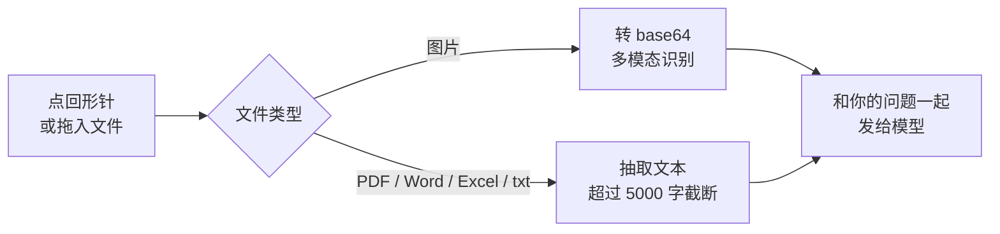

# 使用手册

> 文档索引：[docs/README.md](./README.md)

面向使用者的操作说明。装好并跑起来之后再看这份文档（安装启动见 [README](../README.md) 第 2 节）。

## 0. 启动与退出

**启动**：双击图标，或跑一次 `.\start.ps1`，两者是同一条链路——后端由桌面端自己拉起，脚本不再单独起后端。
安装版自带后端（`resources/backend/`），**不需要装 Python / uv**；开发态才需要本机有 uv。

**启动脚本的常用参数**（只在源码方式下用得到）：

| 命令 | 用途 |
|---|---|
| `.\start.ps1` | 正常启动：检查环境 → 装依赖 → 判定存储 → 开窗口 |
| `.\start.ps1 -DryRun` | 只检查环境与数据库，不装依赖、不开窗口 |
| `.\start.ps1 -SkipDocker` | 不启动任何容器，只用已经在跑的 MySQL |
| `.\start.ps1 -NonInteractive` | 不等待键盘输入（给脚本或计划任务调用） |

每次运行都会把过程写进仓库根目录的 `start.log`：屏幕上停在哪一步，文件里能查到。
退出码含义：1 环境（含端口占用）/ 2 配置 / 3 数据库 / 4 依赖 / 5 启动失败。

**首次启动会自动完成这些事，不需要你动手**：

- 源码方式：从 `backend/.env.example` 复制出 `backend/.env`，并生成一个随机 `JWT_SECRET`
- 建表：SQLite 文件 `backend/data/suixinwenda.db` 在首次启动时自动创建
- 安装版：从 `resources/backend/.env.example` 复制出 `%APPDATA%\suixinwenda-desktop\config.env`，数据也在同目录的 `data\` 下

**两种形态的数据放在哪**（升级或重装时最关心这个）：

| 形态 | 配置 | 聊天记录与附件 |
|---|---|---|
| 安装版 | `%APPDATA%\suixinwenda-desktop\config.env` | `%APPDATA%\suixinwenda-desktop\data\` |
| 源码方式 | `backend\.env` | `backend\data\` |

**覆盖安装新版本不会丢数据**：安装版的数据放在 `%APPDATA%` 下，常规卸载也不会删除，重装或升级后自动接上。
只有用开始菜单里的「彻底卸载（含本地数据）」才会连会话、附件与配置一起删掉。

- 先出现一个 420×300 的小窗（logo + 一行真实阶段文字 + 底部细进度线），首次约 3~4 秒，之后约 1~2 秒。
  文字依次是「正在启动本地服务…」→「正在等待服务响应…」；首次冷启动超过 1.5 秒会先显示「首次启动稍慢，请稍候…」。
- 主窗口出现时后端已经就绪，不会先闪一段「连接失败」；只有后端真的没起来才会在消息区顶部出离线横幅。
- 小窗可以用鼠标拖动，也可以直接 Alt+F4 关掉——关掉不代表退出，主窗口随后照常出来。
- 如果后端起不来（端口被别的程序占、`.env` 写坏等），小窗用红字说明原因并停留约 1 秒，然后仍然进主窗口：
  界面进入离线态，横幅上有「立即重试」，修好后点它就能连上，不会把人卡在小窗里。

**卸载**：`设置 → 应用 → 已安装的应用 → 随心问答 → 卸载`。如果安装目录被移动/删除导致卸载入口失效，
用开始菜单里的「随心问答 - 彻底卸载（保留数据）」或「随心问答 - 彻底卸载（含本地数据）」，
双击后会先列清单、输入 `yes` 才执行（详见 [打包与发布](./打包与发布.md) 的「卸载与清理残留」）。

**退出**：点 ×、Alt+F4、菜单「对话 → 退出」都是同一条路径。

- 主窗口先消失，换成「正在退出…」小窗，底部小字变成「正在关闭本地服务」，进程真正收完后小窗才消失（通常 1~2 秒）。
- 关掉之后任务管理器里不会留下带 `run.py` 的 `python.exe`（安装版是 `suixinwenda-backend.exe`），8010 端口立刻能重新使用。
- 如果你是先用命令单独起的后端（`uv run python -m uvicorn main:app --port 8010`），关窗口不会杀掉它，下次打开会直接复用它。

## 1. 界面一览

```
┌──────────────────────────────────────────────────────────┐
│ [logo] 随心问答                              －  □  ×      │  标题栏 44px（可拖动）
├──────────────┬───────────────────────────────────────────┤
│ + 新对话     │ ⇤  当前会话标题        历史 搜索 主题 更多 │  主区顶栏 56px
│ 搜索会话     ├───────────────────────────────────────────┤
│ 今天  2      │                                           │
│ 报销单怎么写 │              消息区                       │
│ 周会纪要     │                                           │
│              │                                           │
├──────────────┤  ┌─────────────────────────────────────┐  │
│ 未登录  登录 ⚙│  │ 发消息…                         ↑  │  │  输入坞
└──────────────┴───────────────────────────────────────────┘
```

- 左侧栏（272px，可拖 200–360px、双击复位、`Ctrl+B` 收起）：新对话、搜索会话、按「今天 / 昨天 / 过去 7 天 / 更早」分组的会话列表（分组标题可点开收起、条目右键可重命名 / 删除）、左下角账号卡片与设置齿轮
- 主区顶栏：左侧是收起 / 展开侧栏（同一格交叉淡入）与当前会话标题；右侧依次是「对话历史」「在对话里搜索」「切换主题」「更多」
- 输入坞：工具栏（附件、模型下拉、字数）+ 多行输入 + 圆形发送键 + 免责提示
- 除主窗口外，设置、对话历史、登录 / 注册、模型、切换存储、从备份恢复、文件预览、图片灯箱、重命名、确认框都是**独立窗口**：可拖动、位置会记住、`Esc` 关闭（设置 / 对话历史 / 预览 / 灯箱 / 模型 / 提示词库 / 切换存储可缩放，其余固定尺寸）；开着设置也能照常聊天

## 2. 登录与注册

不登录也能聊（匿名会话）。登录后会话归属到你的账号（换一台机器登录同一个账号，只能看到那台机器上自己产生的会话，历史不会跨设备同步），并会自动认领**本机**登录前产生的那些匿名会话。


> 匿名会话没有身份隔离：同一台机器上不登录产生的会话都属于同一个「匿名身份」。多人共用一台机器时请各自注册账号。

| 动作 | 怎么做 |
|---|---|
| 注册 | 点左下角账号卡片 → 登录窗口 →「注册」tab → 填账号（3~50 位，中文/字母/数字/`_ . @ + % -`）+ 密码（6~64 位，输两次）+ 昵称（选填，≤20 字）→ 提交，注册成功直接登录 |
| 登录 | 「登录」tab → 账号 + 密码（账号不区分大小写） |
| 记住我 | 登录窗口里的勾选框（默认勾选）；不勾则下次启动要重新登录 |
| 访客 | 窗口左下角「以访客身份使用」，等于直接关窗：不登录也能聊 |
| 改昵称 | 点左下角账号卡片 →「修改昵称」（账号不能改，昵称能改） |
| 退出 | 点左下角账号卡片 →「退出登录」（只清本地令牌，不通知服务端，之后仍可继续聊） |

> **不需要手机号或邮箱**：本机账号自己取名字就行，项目不做手机号 / 邮箱归属验证，也不接短信服务。
> 密码是本机唯一的凭据，丢了没有找回通道（「一键清除」只清会话、保留账号），请记牢。
> `backend/.env` 里的 `MOCK_CODE` / `DEMO_CODE_MODE` 与 `/send_code`、`/login_by_code` 两个接口仍保留，只用于演示与自动化测试，前端已收起验证码登录入口。

## 3. 聊天

| 操作 | 说明 |
|---|---|
| 发送 | 输入框回车；换行用 `Shift + Enter` |
| 等待 | 气泡里会显示「N s ｜ 正在解析附件 / 正在生成」，超过 15 秒（慢模型 8 秒）会提示可以停止；答完后耗时留在操作条上 |
| 停止生成 | 生成过程中发送按钮变成停止（圆环 + 方块），点它就真的中断：只保留已显示的部分，后台不会继续生成，切回会话也不会突然补出一整段回答；一个字都没出来时停止，就不留这条回答 |
| 重试 | 出错时气泡底部有「重试」 |
| 重新生成 | 只挂在**最后一条 AI 回复**的操作条上（常显，不用悬停）：生成新回答并替换显示（不新增提问、保留原附件），刷新历史不会多出一组问答；这条后面还有消息时，会先弹确认窗口 |
| 回退上一版 | 重新生成成功后，同一条回复的操作条会临时多出「回退上一版」，点了立刻换回旧回答且不重新请求模型；用过即消失，切会话或刷新后不再出现 |
| 复制 | AI 回复的操作条常显「复制 / 朗读 / 重新生成」，复制的是原始 Markdown；代码块右上角另有「复制」（超过 16 行默认折叠，可展开 / 收起）；朗读只在回答 ≥ 80 字且系统有中文音色时可用，再点一次即停止 |
| 用户消息 | 只有「复制」和时间，**没有编辑**（后端不提供改消息接口） |
| 字数上限 | 单条 4000 字，超出时输入框提示且发送被禁用 |

回答支持 Markdown 渲染：标题、加粗、列表、行内代码、代码块、引用、链接；带超长附件正文的提问默认收起在气泡里，点「展开全文」看全。

会话内查找：`Ctrl + F` 打开搜索条，命中处上色，`Enter` / `Shift + Enter` 在命中之间跳，`Esc` 关闭。

**提示词库**：「更多」菜单 →「提示词库」，打开一个独立窗口，用来存常用提问模板（只存本机，不上传，不依赖后端，离线也能用）。

| 操作 | 说明 |
|---|---|
| 添加 | 填标题 + 正文（正文最多 2000 字），点「添加」或在标题框里按 `Enter`；新条目排在最前面 |
| 复制 | 条目右侧「复制」把正文放进剪贴板，回到输入框粘贴即可（**不会自动发送**） |
| 搜索 | 顶部搜索框按标题或正文实时过滤 |
| 删除 | 条目右侧「删除」，立即生效、不可撤销 |
| 上限 | 最多 100 条；超出后新增会把最旧的挤出去 |
| 默认内容 | 首次打开自带 3 条示例（代码审查 / 长文摘要 / SQL 优化），可直接删改 |

## 4. 附件提问

点输入框左侧的回形针（可按住 Ctrl / Shift 多选）、把文件拖进窗口，或直接 `Ctrl + V` 粘贴截图。一次最多 9 个附件，单个 10 MB、合计 30 MB 以内；每个附件都能单独「查看」或「×」移除。

如果当前模型声明「不支持图片/文件」，回形针会被禁用并在悬停时说明原因，换一个模型即可恢复。

附件会以卡片形式留在消息里：图片点一下进灯箱（滚轮缩放、拖动平移、可另存），文档点开看抽取后的正文（超过 5000 字会标注截断），也可以「用系统程序打开」。历史会话里的附件重启后依然能点开。



| 类型 | 格式 | 处理方式 |
|---|---|---|
| 图片 | png / jpg / jpeg / gif / webp | 以多模态方式直接送给模型识别 |
| 文档 | pdf / docx / xlsx / xlsm / md / txt / csv / json | 抽取文本后送模型，超过 5000 字会截断 |

限制：单文件 10 MB 以内、合计 30 MB、一次最多 9 个；老格式 `.doc`、`.xls` 和损坏文件会被后端拒绝并给中文提示。
原文件留在本机（开发态 `backend/data/uploads/`，安装版 `%APPDATA%\suixinwenda-desktop\data\uploads\`，按内容哈希分目录、同一份文件只存一份），
元数据与抽取正文记在本机数据库里，删除会话时一起清理。

## 5. 模型

模型由你自己在「设置 → 模型」里添加（Base URL + API Key + 模型 ID），
选哪个模型就走哪个模型自己的 Key。添加、验证、删除的完整说明见 9.6 节。

输入坞的模型下拉里显示「暂无模型」时，说明一个模型都还没添加，先加一个再聊。

## 6. 对话历史

点主区顶栏的「对话历史」，会打开一个独立窗口，用来看模型这一轮实际看到的上下文（含自动压缩出的摘要）。

- 只算当前会话，不跨会话、不跨设备，删会话即清空
- 保留最近 10 轮原文；更早的内容由后台压成一段中文摘要（每积压 5 轮刷新一次，晚一轮生效属正常）
- 带过图片的消息显示缩略图，点开可看大图；图上标「未重放」表示那张图已超出重放窗口（最近 5 轮），模型这一轮没看到它
- 窗口里会包含你刚发、还没被回答的那条提问，属于正常表现
- 窗口标题显示的是当前会话名（不是固定的「对话历史」），切了会话标题跟着变；没有会话名时才显示「对话历史」
- 只读：不提供编辑与删除，上下文与摘要由后端自动维护
- 删除会话会同时删掉它的消息、附件与摘要

## 7. 历史会话

| 操作 | 说明 |
|---|---|
| 排序 | 按最后一次发言时间倒序：消息一发出去这个会话就顶到最前，不用等模型答完 |
| 载入 | 左侧点会话标题，右侧显示该会话全部消息 |
| 搜索 | 顶部「搜索会话」按标题过滤，命中词高亮；`↑↓` 选择、`Enter` 打开、`Esc` 清空 |
| 分组 | 点分组标题（今天 / 昨天 / 过去 7 天 / 更早）收起或展开该时间段 |
| 重命名 | 右键会话 →「重命名」，输入新标题后回车保存（最多 60 字） |
| 删除 | 右键会话 →「删除」→ 确认；删除后回到新对话（附件文件一并清理） |
| 续聊 | 载入后直接发消息，接着原来的上下文聊 |
| 草稿 | 没发出去的文字按会话各存一份，切走再切回（甚至重启）都还在；发送后自动清空 |
| 键盘 | 会话条目 Tab 聚焦后 Enter 打开、`Shift + F10` 打开右键菜单（重命名 / 删除）；重命名与删除确认都在独立窗口里完成 |

## 8. 主题

顶栏「主题」按钮、设置 → 外观里点选，或快捷键 `Ctrl + Shift + L` 切换深浅色，选择会记住。同一分区还能调正文字号（小 / 标准 / 大），只影响消息与输入区。系统开启「减少动态效果」时，界面动效会自动关闭。

## 9. 设置

点左下角「设置」或按 `Ctrl + ,`，左侧分五区：外观 / 连接 / 数据与备份 / 模型 / 关于。

### 9.1 接口地址（设置 → 连接）

- **接口地址**：后端地址，默认 `http://127.0.0.1:8010`；**必须以 `http://` 开头且主机是 `127.0.0.1` 或 `localhost`**，填局域网 / 外网 / `https` 地址都会提示不支持并拒绝保存（登录令牌不外发）
- **保存**与**检测连接**是两个动作：保存只写配置（存在 `%APPDATA%\suixinwenda-desktop\config.json`，窗口不关）；
  检测才真的请求一次 `/health` 并刷新模型列表，结果显示在输入框下方（未检测 / 检测中 / 已连接 · N 个模型 / 连接失败）
- 输入框里改了地址但还没保存时点检测，会提示「本次仍会连已保存的地址」，不会出现「检测通过但实际没生效」

### 9.2 存储：本机 SQLite（默认）与 MySQL（设置 → 数据与备份）

应用自带两种存储，**默认本机 SQLite**（`backend/data/suixinwenda.db`，首次启动自动建，不用装任何数据库）。
想用 MySQL 8，就在「设置 → 数据与备份 → 切换存储…」打开的窗口里操作：

- 窗口顶部先选**目标存储**（本机 SQLite / MySQL），选 MySQL 才会展开连接表单；
- **主机** 默认 `127.0.0.1`、**端口** `3306`、**用户名** `root`、**库名** `suixinwenda`（与 `.env.example` 的默认值一致）；
- **密码必须填**：填完点「测试连接」，成功会告诉你目标库是空的、还是「已有 N 个会话」；
  密码为空时表单会直接拦住——后端的数据库连接必须带密码，空密码会让切换后的后端启动失败；
- 测试通过后点窗口底部「切换」，应用会写配置并重启后端（约 2 秒，切换窗口里显示进度，期间不能关闭该窗口），失败自动回到原存储；
- **密码加密存储**：写进配置文件的是 `DB_PASSWORD_ENC`（系统加密，Windows 走 DPAPI），
  开发态写 `backend/.env`、打包态写 `userData/config.env`，文件里 grep 不到明文；后端要的明文由桌面端解密后注入。
  打开「切换存储」窗口时，表单回显的也是**当前真正生效**的主机 / 端口 / 用户名 / 库名（密码留空待填），不是默认值；
- `.env` 里 `DB_*` 连接项在模板中全是注释行（生效的只有 `DB_BACKEND` 与 `DATA_DIR`），切换后文件里会同时出现「注释模板 + 生效值」，属正常现象。

两种存储**互相独立**：切换不搬运、不删除任何数据，切回去就能看到原来那份。**切过去看到空列表是正常的。**

#### 连远程 MySQL

主机填 `127.0.0.1` / `localhost` / `::1` 以外的地址都算远程，**必须勾选「允许连接远程数据库」**，
否则表单直接拦住（后端也不会启动）。勾选等于明确同意「聊天记录会保存到那台机器上」。

- **附件不会跟着走**：数据库共享了，`uploads/` 还在本机。换一台电脑连同一个库，会话在、图片会裂；
  要搬历史用「导出数据 → 从备份恢复」。
- **建议同时填「CA 证书」**：填了之后后端与「测试连接」都走 TLS 并校验证书。跨公网不加密 = 密码与聊天内容明文过网。
- **网络侧**：不要把 3306 直接映射到公网；用内网 / VPN，或云上私网 + 安全组只放行你的出口 IP。
- **账号**：用专用账号并只授权 `suixinwenda` 库，但**要保留建表权限**（首次启动会建表、补索引）。
- 先手动 `CREATE DATABASE suixinwenda DEFAULT CHARSET utf8mb4`；切过去是空库。
- 本机 MySQL 与远程 MySQL 是两个独立的库：附件目录、自动备份池、备份文件名都按 `host/端口/库名` 区分，来回切换互不影响。
- 切换前应用会自动跑一次连接探测：密码不对 / 库不存在 / 端口不通会当场给中文原因，不会等到「后端进程已退出」。

手动启动后端（不走桌面端）时，如果看到的报错是「DB_PASSWORD 在配置里是加密存储的」，
在 `backend/.env` 里临时写一行明文 `DB_PASSWORD=你的密码` 再启动即可。
开发态的 `backend/.env` **不会**被自动加密（它同时是你手动启动用的配置）；只有打包态的 `config.env` 会自动迁移，
或者你在界面上点过一次「切换存储」（那条路径永远写密文）。

### 9.3 备份 / 导出 / 恢复 / 一键清除

| 动作 | 产物 | 里面有什么 |
|---|---|---|
| 立即备份 | 一个 `.zip` | 当前库快照 + 当前后端的全部附件 |
| 导出数据 | 一个目录（`manifest.json` + 每表一个 `.jsonl`） | 业务表的结构化数据，**不含附件** |
| 从备份恢复 | — | 把上面两种产物写回当前库 |
| 一键清除本库数据 | — | 删会话 / 消息 / 摘要 / 附件文件，**账号保留** |

- 备份**只含业务表**；老库里停用的 `checkpoint*` 历史表会被跳过（`manifest.json` 里 `included_tables` / `skipped_tables` 写明；
  白名单里有、但库里没建的表也会列进 `skipped_tables`，让你能看出这次没覆盖哪张表）。
- 备份位置与名称由保存窗口给出，默认在 `%APPDATA%\suixinwenda-desktop\backups\`，时间戳是本地时间。
- MySQL 备份优先用 `mysqldump`，没装也能用内置导出（标准 SQL，可直接执行），**不需要额外装东西**。
- **恢复**：点「从备份恢复」→ 选备份包（`.zip`）或「导出数据」生成的目录 → 需要时勾「将先备份当前库，再清空当前库」。
  - 恢复窗口里会列出**最近的 8 份备份 / 导出**（按时间倒序，缺文件的不列）：点一行即选为恢复来源；
    zip 行右侧还有「设为附件」，用于给导出目录补附件。不用每次自己去文件夹里翻；
  - 没有历史记录时会提示「先点立即备份」，仍可用「选备份…」「选目录…」手动指定；
  - 不勾时，当前库已有会话会被**直接拒绝**（不备份、不写库），提示里会告诉你先「一键清除」或改勾选；
  - 勾了会**先自动备份当前库**（恢复失败时这就是回滚文件，结果页会给出路径与「打开所在文件夹」）；
  - 库里已有的账号按 `username` 合并，**不会覆盖密码与创建时间**；
  - **导出目录不含附件**：想让附件一起回来，在「附件来源」里选同一个备份包（命令行 `--uploads-from`）；
  - 恢复期间点窗口 × 会被拦住（工具子进程还在写库）。
- **一键清除不可逆**：会物理删除当前后端的附件文件；账号保留，所以清完可以直接登录。

### 9.4 定期自动备份

不主动点备份也要有退路：设置 → 数据与备份里有「开启定期自动备份」（默认开）与「间隔天数」（默认 7，可填 1~90）。

- 每次启动、后端就绪后检查一次：最近一份备份（**手动或自动都算**）距今超过设定天数，就在后台静默生成一份；
- 产物是 `data/backups/before-auto-<后端>-<时间戳>.zip`，与升级前 / 恢复前的自动备份**各留最近 5 份**，互不挤占；
- 生成期间退出会被拦住（和手动备份一样），不会留下写了一半的包；
- 一份备份都没有时（首次使用）同样会触发——那正是最需要退路的时候；
- 改开关或天数当场生效（写进 `%APPDATA%\suixinwenda-desktop\config.json`），下一次启动按新设置检查。

### 9.5 备份产物（设置 → 数据与备份 → 备份产物）

存储区下方列出**本应用生成的**产物（最多 20 条），每行可：「用它恢复」/「打开所在文件夹」/「删除」；
文件被手动移动或删掉后，该行会显示「文件已移动或删除」，并给出「重新定位」（重新指向新位置）与「移除记录」（只清列表，不碰磁盘）。

「用它恢复」会直接打开恢复窗口并带上来路（zip 作恢复来源、目录作导出目录来源），省掉再翻一次文件夹。

「清理 30 天前的产物」会先列出待删清单（名称、体积、时间），确认后才删，完成后提示删了几项、释放多少 MB：

- 只清**备份与导出**，不含升级前 / 恢复前 / 定期的自动备份（那些由应用按份数自己管理）；
- 用户改过名的产物同样会被清（判定标准是「在不在本应用的产物清单里」，不看文件名前缀）。

### 9.6 模型管理（每个模型一把 Key）

聊天模型由你自己维护：设置 → 模型。兼容 OpenAI 协议的接口都能接
（DeepSeek、通义千问、各种中转站、私有化部署）。

**添加模型**：点「添加模型」（开一个独立窗口）→ 选供应商（DeepSeek / 通义千问 / 自定义，选中后自动填地址与建议模型 ID）→
填 **Base URL、API Key、模型 ID**，再起一个显示名称。两个可选开关：
「支持图片输入」（关掉后前端禁用图片附件）与「推理模型」。
后者只是写进模型能力位：后端目前不回传推理内容，界面也不会出现「查看推理过程」区域，属预留能力。

**保存与生效**：点「保存并应用」后会自动重启本地服务（约 2 秒，模型窗口里显示进度），
成功提示「已生效：N 个可用模型」，失败给出中文原因且**旧配置仍然有效**。
保存后会自动验证一次：可用显示绿字，Key 错 / 模型 ID 错显示红字与具体原因。

**要点**：

- **每个模型用自己的 Key**：选哪个模型，聊天就走哪个模型自己的 Base URL 与 Key，不存在切错 Key 的问题；
- **Key 属于这台电脑**，本机所有账号共用（额度也共用）；退出 / 换账号登录不用重填；
- Key 加密保存在 `%APPDATA%\suixinwenda-desktop\models.json`（Windows 走 DPAPI），界面只显示「已配置」，不回显；
- 编辑时 Key 留空 = 不修改；「清除 Key」后该模型不可用但配置保留；
- **可以删到空**：删完最后一个后主区会出现「去添加模型」横幅，发送键禁用；删掉的正好是默认模型时，默认自动落到剩下的第一个，删空则默认值一并清空；
- 老版本 `.env` 里已有的 DeepSeek / 千问 Key 会在首次启动时自动迁移（加密），不用重填。

## 10. 导出

`Ctrl + S` 或菜单「对话 → 导出为 Markdown」，选保存位置即可导出当前会话为 `.md` 文件。

注意区分：这里的「导出为 Markdown」只导出**当前会话的文字**；设置里的「导出数据」导出的是**整库的结构化数据**（见 9.3）。

## 11. 快捷键

| 快捷键 | 作用 | 生效范围 |
|---|---|---|
| `Ctrl + N` | 新对话 | 主窗口 |
| `Ctrl + S` | 导出当前会话为 Markdown | 主窗口 |
| `Ctrl + F` | 打开 / 关闭会话内搜索 | 主窗口 |
| `Ctrl + B` | 收起 / 展开侧栏 | 主窗口 |
| `Ctrl + Shift + L` | 切换深浅色主题 | 主窗口 |
| `Ctrl + ,` | 打开设置 | 主窗口 |
| `Enter` / `Shift + Enter` | 发送 / 换行 | 输入框 |
| `Ctrl + W` | 关闭当前窗口 | 独立窗口 |
| `Esc` | 关闭当前窗口（有未完成的长任务时会被拦住并提示） | 独立窗口 |

## 12. 离线与重连

后端没启动时：

- 消息区顶部出现横幅「后端连接失败，正在自动重连（第 N 次，每 5 秒一次）」，右侧有「立即重试」
- 左侧栏换成一句「后端连接失败，暂时看不到历史会话」，不留一直闪的骨架条
- 也可以到 设置 → 连接 点「检测连接」手动重连
- 后端起来后自动恢复（在线 15 秒一轮、离线 5 秒一轮轮询），并弹一条「后端已连接」

## 13. 常见问题

| 现象 | 处理 |
|---|---|
| 登录提示「用户名或密码错误」 | 账号不存在或密码不对；先注册（账号不区分大小写） |
| 弹提示「登录已过期」 | 令牌有效期 7 天，重新登录即可；并发请求只会提示一次 |
| 附件上传失败 | 看提示：超过 10 MB / 合计超过 30 MB / 格式不支持 / 文件损坏，提示各不相同 |
| 回答里出现「生成失败，请稍后重试…」 | 模型 Key 无效、额度不足或网络不通；到 设置 → 模型 点「验证」看具体原因 |
| 顶部提示「还没有可用的模型」 | 一个模型都没添加：点横幅「去添加模型」 |
| 窗口打不开或白屏 | 关掉所有残留的 electron 进程后重开；仍不行看主进程控制台报错 |
