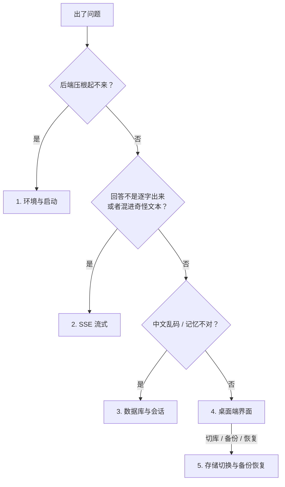

# 踩坑与 FAQ

> 文档索引：[docs/README.md](./README.md)

按**现象**查的排错手册：每条都给「现象 → 根因 → 处理」，照着做就能自己解决。
这里只收录**你现在或以后仍可能遇到**的问题——已经不可能再发生的历史缺陷不写进来。

**按角色选读**：第 1–5 节（环境与启动、SSE、数据库与会话、桌面端、存储切换与备份）是**使用中**会遇到的问题；
第 6、7 节（改完代码的注意事项、打包冒烟与 CI）面向**开发与维护者**，只是用应用的话可以跳过。
想知道某个实现「为什么是现在这样」，看 [docs/dev/设计取舍.md](./dev/设计取舍.md)。

先按这张图定位到对应小节：



- 装不上、起不来 → [1. 环境与启动](#1-环境与启动)
- 回答不出来、不是逐字、混进摘要 → [2. SSE 流式](#2-sse-流式)
- 乱码、记忆没清、越聊越慢 → [3. 数据库与会话](#3-数据库与会话)
- 界面卡住、样式没变、登不上 → [4. 桌面端](#4-桌面端)
- 备份包巨大、恢复报错、切换存储失败 → [5. 存储切换与备份恢复](#5-存储切换与备份恢复)

## 1. 环境与启动

### 中文存进数据库变乱码
- **根因**：连接串没带字符集，或建表用了别的字符集。
- **解决**：连接串固定带 `?charset=utf8mb4`（`core/database.py`），业务表建表写死 `utf8mb4`（`models/*.py`）。用仓库自带 `docker-compose.yml` 起库可避免。

### 后端窗口报 `uv trampoline failed to canonicalize script path`
- **根因**：`.venv\Scripts\*.exe` 是 uv 生成的 trampoline（内嵌创建时的绝对路径）。项目目录被移动/改名、或 `.venv` 从别处整体拷过来之后，内嵌路径失效就报这个；`uvicorn` 包本身没坏。
- **现象**：后端起不来——`start.ps1` 走到「启动桌面端」后，窗口停在启动小窗并进入离线态；`backend\backend.log` 末尾能看到这句报错。
- **解决**：删掉 `backend\.venv` 后重新 `uv sync`。`start.ps1` 与本文命令已统一用 `uv run python -m uvicorn`，不经过这层 exe，日常启动不会再触发。

### 端口 8010 被占，二次启动报 `Errno 10048`
- **现象**：用 `start.ps1` 启动时，会在「检查服务端口」阶段直接报出占用端口的 PID 与进程名并以退出码 1 结束；手动起后端才会看到 `Errno 10048`。
- **根因**：上一次的后端没退干净（杀掉父进程后子进程 `uvicorn` 还在）。
- **解决**：`netstat -ano | findstr :8010` 找到 PID 后 `taskkill /PID <pid> /F`；或改 `backend/.env` 的 `BACKEND_PORT` 并同步改桌面端设置。

### `start.ps1` 报「表达式或语句中包含意外的标记 `}`」
- **根因**：脚本里全是中文，若存成 **UTF-8 无 BOM**，Windows PowerShell 5.1 会按 ANSI 解析，中文字节破坏字符串配对，报错行号还会指到一个看着完全正常的括号。
- **解决**：保存为 **UTF-8 with BOM**（VS Code 右下角编码 → Save with Encoding → UTF-8 with BOM），或用 PowerShell 7（`pwsh`）执行。仓库里的 `start.ps1` 已经是 BOM 版本，自己改完记得保持。

### `start.ps1` 一运行就报 `NativeCommandError`（Docker 没启动时）
- **现象**：跑 `.\start.ps1` 后立刻刷出 `docker inspect ... failed to connect to the docker API`，脚本直接退出；而 `backend/.env` 明明写的是 `DB_BACKEND=sqlite`。
- **根因**：旧脚本把 Docker 探测放在「判定用哪个库」之前，整条脚本又是 `$ErrorActionPreference='Stop'`——原生命令往 stderr 写一行就被抬成终止性错误，`2>$null` 只压显示、不拦错误流。
- **解决**：脚本已重写——外部命令统一走封装（只认输出，不依赖错误流），存储判定交给 `uv run python -m tools.db_info` 由后端回答，只有确定走 MySQL 才碰 Docker。默认 SQLite 路线现在一条 docker 命令都不会执行。

### `start.ps1` 启动后控制台日志全是乱码（`锛氣€` / `����` 之类）
- **现象**：窗口能起来，但控制台刷出的后端日志是乱码，看不出启动到哪一步。
- **根因**：PowerShell 5.1 读外部命令输出时按系统 ANSI 代码页（简体中文 936）解码，而 node / Electron 写的是 UTF-8 字节；改 `[Console]::OutputEncoding` 对这条路径无效（实测三种写法都乱）。
- **解决**：脚本已按用途分开处理——需要解析的输出走「临时文件 + 按 UTF-8 读文件」，桌面端用 `Start-Process` 直连控制台（不经过 PowerShell 转码）。自己加命令时也照这个规则：**要解析输出就用文件重定向，不要用管道读取**。

### `start.ps1` 跑完窗口没起来，该看哪里
- **现象**：屏幕上滚过几行就结束，窗口没出现，也不知道停在哪一步。
- **根因**：可能是环境、配置、数据库、依赖、启动五层里的任意一层。
- **解决**：先看仓库根目录的 `start.log`——最后一行会写「退出码 N」，对照：
  `1` 环境（缺 uv/node、Node 版本低、路径含中文、目录不可写、8010 被占）；`2` 配置（`.env` 字段非法）；
  `3` 数据库；`4` 依赖安装失败；`5` 启动期失败。
  脚本日志说明「卡在哪一步」，后端原因再配合 `backend\backend.log` 看。
  只想快速体检、不开窗口：`.\start.ps1 -DryRun`。

### 项目路径含中文或空格，安装依赖或打包失败
- **现象**：`uv sync` / `npm ci` 报路径不存在；或 `npm run dist` 在 PyInstaller 阶段失败。
- **根因**：部分工具链对非 ASCII 路径与空格处理不稳（Electron 缓存目录、PyInstaller 临时目录、NSIS 打包）。
- **解决**：把仓库移到纯英文、无空格的路径（如 `E:\projects\suixinwenda`）后重跑。`start.ps1` 的「检查环境」阶段会对这两种路径给出告警。

### 启动即报「缺少配置项：JWT_SECRET」
- **根因**：`.env.example` 里的 `JWT_SECRET` 留空（不给一个永远能跑的占位串，防止带着弱密钥上线）。
- **解决**：用根目录 `start.ps1` 启动会自动生成并写回；手动启动时执行 `python -c "import secrets;print(secrets.token_urlsafe(48))"`，把结果填进 `backend/.env` 的 `JWT_SECRET=`，重启后端。

### 复制 README 里的命令报「标记“&&”不是此版本中的有效语句分隔符」
- **根因**：Windows PowerShell 5.1 不支持 `&&` 串联命令。
- **解决**：一行一条执行；或用 PowerShell 7（`pwsh`）执行；文档里的命令都已按可逐行执行写成。

### `npm install` 显示成功，但 `npm start` 起不来
- **根因**：npm 新版本默认拦截依赖的安装脚本，Electron 的二进制没被下载。
- **解决**：检查 `desktop/node_modules/electron/dist/electron.exe` 是否存在；缺则：

  ```powershell
  cd desktop
  node node_modules/electron/install.js
  ```

  下载慢时先设镜像 `ELECTRON_MIRROR=https://registry.npmmirror.com/-/binary/electron/`。

### 打包卡在下载 Electron / builder 依赖
- **根因**：默认走 GitHub 源。
- **解决**：`desktop/tools/build.js` 已内置 npmmirror 两个镜像环境变量，用 `npm run dist` 打包即可。

### PowerShell 里用 `curl.exe` 发 JSON 全部 422
- **根因**：PowerShell 会吞掉内嵌双引号。
- **解决**：改用单引号包 JSON，或直接用 `/docs` 页面 Try it out，或用 Python `requests` 发。

## 2. SSE 流式

### 回答不是逐字出来，而是一次性蹦出来
- **根因**：SSE 响应头不完整，中间层做了缓冲。
- **解决**：返回 `StreamingResponse` 时必须带 `Cache-Control: no-cache` 与 `X-Accel-Buffering: no`（`routers/chat.py` 的 `SSE_HEADERS`）。

### 回答里混进「把以下对话压缩成摘要」之类的内部文本
- **根因**：摘要是一次独立的模型调用，如果它和聊天流共用同一条输出通道，摘要正文就会混进用户看到的气泡。
- **解决**：摘要已与聊天流彻底分离——`core/summary.py` 在后台任务里单独调模型、单独落 `chat_summaries`，`core/chat.py::stream_reply` 只处理当前这条聊天流；上下文由 `core/context.py` 从数据库重建，不走任何模型侧钩子。

### 流式报 `NotImplementedError`
- **根因**：历史上用 LangGraph checkpointer 承载记忆时，它要求 checkpointer 提供异步方法，同步实现直接塞进去会报这个。
- **现状**：checkpoint 已停写、相关模块已删除，本项目不会再走到这条路。若从旧版本迁移代码时复现，说明搬回了旧实现，直接删掉即可。

### 「停止生成」按钮点不到
- **根因**：前端把整个流式请求 `await` 掉了，状态永远停在「等待响应」。
- **解决**：用 `AbortController`，点停止时 `abort()`，并在 `catch` 里区分主动中断与真实错误。

### 点了停止，当时是空的，切回会话回答又整段冒出来
- **根因**：前端 `abort()` 只断了浏览器这一端；后端在 `_iter_sync_stream` 的 `finally` 里对正在另一个线程里执行的生成器调 `close()`，会抛 `generator already executing`，模型照样把整段答完并落库，下次拉历史就看见完整回答了。
- **解决**：改成协作取消——`StreamingResponse` 这一侧只 `set()` 一个 `threading.Event`，`core/chat.py::stream_reply` 每产出前检查它并 `break`；落库只写已经发给用户的片段，一个字都没出来就不写 assistant。`test_chat_cancel_*` 两个用例守着这条路径。

### 日志里的 `ConnectionResetError: [WinError 10054]`
两种形态，先看清是哪一种再决定要不要管：

1. **只有一行 `ERROR asyncio: ... _call_connection_lost` + `WinError 10054`**
   - **含义**：客户端已经断开 SSE，服务端还往这条连接写数据，Windows 用 10054 把这个情况报出来。请求本身已经结束，紧接着的下一请求仍正常返回 200。
   - **处理**：这是已知噪音，**无害可忽略**。点「停止」、关窗口、切会话都会产生，属正常现象。
2. **同一时刻还伴随 `Exception in ASGI application` 堆栈**
   - **含义**：不是单纯断连噪音，得看堆栈落在哪个协程/生成器里。
   - **处理**：先确认是否每次点「停止」都必现；必现就按堆栈定位到对应代码，属另查的问题（断连噪音本身不需要修）。

## 3. 数据库与会话

### 启动报 `Illegal mix of collations`
- **根因**：历史上记忆三表的排序规则和库默认不一致，`json_table` 虚拟列用字符集默认排序规则，两边一撞就 1267。
- **现状**：checkpoint 三表已停写、维护模块已删除，新装环境不再创建这三张表；老库里遗留的三张表不再被读写，这条不会复现。业务表（`SQLModel.metadata.create_all`）统一由库默认字符集建表，不涉及跨表排序规则。

### 建表报错 3763，记忆功能整个起不来
- **根因**：部分 MySQL 兼容实现拒绝 `md5` 生成列的子句（问题出在 checkpoint 三表的建表语句里）。
- **现状**：同上，这三张表已不再创建，3763 不会再出现。业务表没有任何 `md5` 生成列。

### 删了会话，模型还记得内容
- **根因**：历史上只删了业务表、没删 checkpoint 里的记忆线程。
- **现状**：模型上下文只来自 `chat_messages` + `chat_summaries`，删除会话时按会话删业务数据即可，没有第二份记忆需要同步清理。

### 积压很多轮之后摘要不再刷新（或上游报 400 / 计费暴涨）
- **根因**：摘要的 `_condense` 只截断输出（`[:SUMMARY_MAX_CHARS]`），输入是「旧摘要 + 全部新增对话」原样拼接；
  积压几十轮后 prompt 可能几万字，上游直接 400，而这条路径在后台线程里失败——用户只看到「摘要一直不刷新」。
- **解决**：`core/context.py` 增加 `SUMMARY_INPUT_MAX_CHARS`（与其它上下文口径放在一起），
  `_condense_prompt()` 在拼 prompt 前截断：**旧摘要优先保留、新增对话从最新往回取**、整行取舍不切半句，并打一行告警日志。

### 装完应用，聊天里显示「暂无模型」/ 发消息就报错
- **根因**：软件不自带任何模型 Key，模型列表由用户自己在「设置 → 模型」里维护；
  没添加过模型时后端的模型注册表为空，聊天必然失败。
- **解决**：设置 → 模型 → 添加模型（Base URL + API Key + 模型 ID）。
  主区顶部有「去添加模型」横幅直达。保存后应用会自动重启后端并做一次轻量验证。

### 模型列表里有，一发消息就报「API Key 无效」或 401
- **根因**：Key 填错 / 过期 / 余额不足时，模型照样出现在下拉里（后端只看 Key 是否非空就注册），
  真正暴露是在第一次聊天。
- **解决**：设置 → 模型 → 该行点「验证」：后端会用这把 Key 发一次极轻量请求，
  返回「Key 无效或已过期 / 模型 ID 不存在 / 连不上 Base URL / 连接超时」等中文原因，照着改即可。

### 从 MySQL 切到 SQLite 后：一键清除报「no such table」/ 恢复后界面没数据 / 清除显示 0 但列表还有会话
- **根因**（已修复）：打包态里「后端服务进程」与「备份 / 恢复 / 清除这些工具子进程」
  各自解析库位置的方式不同——服务进程回落到程序安装目录下的 resources，工具子进程固定用
  `%APPDATA%\suixinwenda-desktop\data`。两个进程连的是**两个不同的 SQLite 文件**：
  清除 / 恢复 / 备份在工具那个空库上操作（报 no such table、清出 0 个、备出 624 B 的空包），
  而界面数据来自服务进程那个库，看起来就是「怎么清都清不掉」。
- **修复**：打包态启动时把 `DATA_DIR` 钉进 `config.env`，服务进程与工具子进程从此指向同一个库；
  清除 / 导出工具对「还没有表的空库」先幂等建表（报 0 个而不是报错）；
  切换存储在拉起新进程前先确认旧进程真的停了，外部启动的后端则明确拒绝代重启。
- **你机器上的残留**：升级后 SQLite 数据统一在 `%APPDATA%\suixinwenda-desktop\data`；
  之前「切换测试」期间的空库、624 B 空备份可以直接删。你的真实数据在 MySQL 里没动过，
  打开新版本后在「设置 → 数据与备份 → 切换存储」切回 MySQL 即可看到。

### 换了台电脑，模型 Key 要重填吗
- **根因**：Key 加密存在本机（Windows 走 DPAPI，密钥绑定当前系统账户），密文换机器解不开；
  这是加密的代价，不是故障。
- **解决**：新机器上在设置里重新填一次（半分钟）；账号与聊天记录跟数据库走，不受影响。

### 聊天越来越慢，上下文越来越长
- **根因**：消息无限累积。
- **解决**：上下文由 `core/context.py` 从数据库构建，固定保留最近 `CONTEXT_ROUNDS = 10` 轮原文，更早的轮次压成一段中文摘要；摘要在后台任务里由 `core/summary.py` 刷新，触发条件是 `pending = 轮数 - CONTEXT_ROUNDS - covered_rounds >= SUMMARY_BATCH_ROUNDS`（每积累 5 个未覆盖轮刷一次）。阈值不能定太低——每次摘要都是一次完整模型调用。

### 点过「重新生成」之后，前面几轮的回答全从历史里消失了
- **现象**：会话里用户消息一条不少，AI 回复只剩最后一条，而「模型记忆」弹窗里明明一条不缺。
- **口径**：每轮问答最多保留「当前版 + 上一版」两版回答，靠 `chat_messages.superseded` 标记；
  历史列表只显示 `superseded = 0` 的那条。「模型记忆」走的是另一条组装路径，不认这个标记，
  所以会出现「记忆里有、历史里没有」。
- **排查**：先确认是不是**整个会话**的旧回答都不见了（而不是只有本轮）。
  若多轮同时消失，说明降级范围写成了整会话，而正确范围是「本轮 id 最大的那条 active assistant」。
- **处理**：`core/history.py::repair_superseded_flags` 在启动时幂等跑一次——被正常覆盖的旧版一定与新版相邻
  （两条 assistant 连续），所以「后面不是 assistant」的旧版属于被误标记的，恢复成当前版。
  日志里会打 `历史数据修复：N 条被误标记的回答已恢复显示`；重开应用即可生效。

### 为什么有的错误回 409 / 429，而不是统一 400
- **409（conflict）**：账号已注册这类「资源已存在」。用 400 时前端分不清「你参数写错了」和「这东西已经有了」，只能靠文案猜。
- **429（too_many）**：失败次数超限（验证码连错 5 次 → 锁 5 分钟）。它带「过几分钟再试」的语义，属于限流而不是参数错误。
- 映射表唯一源是 `backend/core/errors.py` 的 `KIND_STATUS`；`main.py` 注册了全局 `BizError` handler，所以新路由忘了用 `call()` 包一层也不会退化成 500，只是少一层包装。
- 注意：**只有 Pydantic 校验失败才是 422**，业务异常一律走这张表。

### 简单一句话，思考时间却不稳定地长
- **排查顺序**：看 `backend.log` 里 `首字耗时 x.xxs`（`core/chat.py`）与 `排摘要刷新`（`core/summary.py`，后台任务）。摘要已经在独立线程里跑，不再占用首字前的时间，所以「首字耗时」偏大只剩上游模型首字慢（并发高峰常见）与上下文过大两种可能；既没有 `排摘要刷新`、首字又很正常却仍觉得慢，就是前端渲染侧的问题。

> 本节只讲「遇到这个现象怎么处理」。想知道某个实现**为什么是现在这样**（增量渲染、图片重放预算、上传分块暂存），
> 见 [docs/dev/设计取舍.md](./dev/设计取舍.md)。

## 4. 桌面端

### 打包版莫名连到别的端口 / 配置和开发版串了
- **根因**：打包版与开发版共用同一个 `%APPDATA%\suixinwenda-desktop\config.json`。
- **解决**：属既定设计。做冒烟/联调时用独立配置目录（设置里改接口地址，或临时改 `userData` 路径），别让两边互相覆盖。

### 界面看着「像死页」
- **根因**：后端没起时没有任何反馈。
- **解决**：离线横幅（内含「立即重试」）+ 侧栏占位 + 离线时每 5 秒自动重连；恢复瞬间提示「后端已连接」。

### 离线占位永远不出现
- **根因**：渲染逻辑里有个早退条件命中了页面初始的空状态元素，占位函数提前 return。
- **解决**：用 `dataset.state` 去抖，判断「当前是否已渲染过占位」而不是判断节点是否存在。

### 点「检测连接」后侧栏一直转圈（看起来像反复刷新）
- **现象**：设置里点一次「检测连接」，左侧会话列表变成三条闪烁骨架，检测成功后也不停，像页面在刷新。
- **根因**：`checkApiConnection` 先 `setConnection(null)`，把侧栏换成离线占位（连「还没有对话」空态一起清掉）；
  检测成功后 `conversationsLoaded` 早就是 `true`，没有任何路径再调 `loadConversations()`，
  侧栏就停在带 `is-loading`（infinite 动画）的骨架上。自动轮询每 5~15 秒又会重画一遍，于是「反复刷新」。
- **解决**：侧栏三态收敛到 `desktop/src/renderer/connection.js` 的 `refreshPlaceholder()` 一个出口——
  已有会话条目或空态时任何连接态变化都不许覆盖；`conversationsLoaded` 为真时按内存数据落真态、绝不再铺骨架。
  同时：检测按钮不再改全局连接态；`setConnection` 加「渲染态没变就不重画」的幂等；`conversationsLoaded`
  只在 `loadConversations` 成功后置位、失败回滚（否则首屏失败一次就永久不重拉）。
- **连带修掉**：改接口地址后仍显示旧地址的会话（统一走 `resetAfterDataSwap`）；其它窗口换库 / 恢复 / 清除后
  主窗口不跟随（订阅 `app:backend-restarted` / `app:config-changed` / `app:models-changed`）；
  模型保存/删除触发的后端重启那一轮把 `modelsChecked` 锁死成「暂无模型」。

### 提示条和离线横幅叠在一起
- **根因**：两者都定位在顶部居中。
- **解决**：横幅在场时给提示条加 `.is-below-banner { top: 112px }` 下移避让，不改提示条本身的位置。

### 深色主题下标题栏 logo 露出一块白方块
- **根因**：原图是白底、没有 alpha 通道，容器透明也挡不住图片自带的白底。
- **解决**：改成深浅两套素材——浅色 `assets/logo-mark.png`（奶白底，靠容器圆角裁切），深色 `assets/logo-mark-dark.png`（透明白笔触），
  由 `[data-theme='dark']` 切显隐；**不再**对图片做提亮/反色滤镜（滤镜会把笔触的光晕洗脏）。

### 换了 logo 新图反而颜色变脏
- **根因**：新原图本身就带 alpha，再套用「去白底」脚本等于二次上色。
- **解决**：带 alpha 的图直接用，不要再跑去白底流程；只在需要底板时按「画稿缩放到 60~72% + 圆角底板」重新合成。

### 小尺寸图标糊成一团
- **根因**：直接把 1024px 缩到 16px，细节全丢。
- **解决**：`.ico` 的 32/48/64/128/256 直接取设计稿的逐尺寸导出版（设计师已单独出图），16/24 由 48 版 LANCZOS 降采样
  （比 1024 直缩锐度高），七帧一次性装进 `desktop/build/icon.ico`。

### 换了新 logo，仓库里还是旧配色
- **根因**：界面 logo 是「按文件名读桌面原图裁一次」的一次性产物；设计师把同名原图覆盖成新配色后，脚本没重跑，
  仓库里的派生图就停在旧配色上，光看文件名和尺寸发现不了。
- **解决**：生成逻辑固化成 `desktop/tools/gen-icons.py`——`npm run icons` 重出 ico + 三张 png，
  `npm run icons:check` 做「派生图 vs 现原图」逐像素比对（不一致直接非零退出）。原图同名覆盖后跑这两条即可。

### 弹窗里列表四角内容被裁
- **根因**：容器误用了 `border-radius: 999px`（胶囊圆角），把方形内容切掉。
- **解决**：弹窗类容器用 `16px`，只有胶囊按钮用 `999px`。

### 改了样式一刷新没变化
- **根因**：Electron 缓存了渲染进程资源；且应用菜单被自定义模板替换，里面**没有** `role: 'reload'`，`Ctrl + R` 无反应。
- **解决**：关掉窗口重开（最稳）；或 `npm start -- --dev` 开 DevTools，在 Network 面板勾 Disable cache 后手动 reload。

### 设置里填局域网 / 外网地址存不进去
- **根因**：接口地址白名单只放行本机回环（`127.0.0.1` / `localhost`），主进程 `normalizeApiBase` 与渲染进程同名函数各拦一次。
- **解决**：属既定安全设计（登录令牌不外发）。要在另一台机器上跑后端，请改成用 SSH 端口转发后仍填 `127.0.0.1`。

### 冒烟跑到第二个场景就登不上
- **根因**：验证码改成了「一次性消费」，同一场景里连点两次登录复用同一个 `1234`，第二次必然 400。
- **解决**：测试与手工联调都要在每次提交验证码前重新调 `/send_code`；后端用例已按此调整（`tests/test_user_api.py`）。

### 注册/登录提示「登录响应异常」，或提示登录成功但左下角仍是未登录
- **根因**：真后端回的是裸对象（`/login` 直接 `{access_token, token_type, expires_in, user}`），前端却按 `{code, message, data}` 去读 `body.data`，拿到 `{}` 后令牌为空。假后端当年恰好包了一层，冒烟永远测不出来，只有连真后端才暴露。
- **解决**：渲染进程统一用 `jsonPayload(body)` 抹平两种形状（`code + data` 同时存在才拆包）；`tools/mock-server.js` 的认证接口也已改成裸对象，与真后端对齐。**改后端返回形状时，必须同步假后端，否则冒烟会一直是绿的。**

## 5. 存储切换与备份恢复

### 备份包动辄一百多 MB，解开来全是没人用的死表
- **根因**：内置导出以前是 `SHOW TABLES` 全表导，老 MySQL 库里还留着停用的 LangGraph checkpoint 表，体积占绝大部分。
  更糟的是 `_sql_literal` 对 `bytes` 会写成 `b'...'` 文本，
  MySQL 把相邻字符串字面量拼起来后**不报错、静默存成垃圾**——那部分即使恢复也全是坏数据。
- **解决**：`core/backup.py` 只导业务表（`TABLES` 白名单），MySQL 侧用 `SHOW TABLES ∩ TABLES`
  （不能直接遍历白名单：老库可能根本没建 `chat_summaries`），SQLite 侧在 `VACUUM INTO` 之后删白名单外的表再 `VACUUM`。
  备份包体积随之降到跟真实数据同一量级。

### SQLite 快照删表时 SQLite 报 `cannot VACUUM from within a transaction`
- **根因**：`sqlite3` 连接默认是 legacy 事务语义，`VACUUM` 会被当成「事务内执行」。
- **解决**：连接上先 `conn.isolation_level = None`（autocommit），删表与 `VACUUM` 各自独立提交。
  另外 `with sqlite3.connect(...)` 只管事务**不关连接**，Windows 上没关的连接会锁着文件，临时目录清理报 WinError 32。

### 工具子进程备份/恢复的不是「当前那个库」
- **根因**：工具子进程是独立进程，只能靠 `SUIXINWENDA_ENV_FILE` 找到配置。不给 env 时它会去程序旁边找 `.env`
  （打包态还不存在），静默回落到默认 SQLite——于是操作的是另一个库，**全程不报错**。
- **解决**：`desktop/src/tool-run.js` 的 `toolEnv()` 统一注入 `SUIXINWENDA_ENV_FILE`；
  `DATA_DIR` **只在打包态注入**——`core/config.py` 的 `load_env()` 是「已存在不覆盖」，
  开发态注进 `backend/data` 会压住用户 `.env` 里的 `DATA_DIR`，制造出同款的镜像 bug。

### 切换存储时报「缺少 DB_USER」，界面却显示成功
- **根因**：`restart` 只写了 `DB_BACKEND`，env 里没有 `DB_*`，后端起来就说「缺少配置项：DB_USER」。
- **解决**：设置里加了连接表单，切换时把 `DB_*` 一起写进配置（主进程白名单只放行
  `DB_BACKEND` + 连接相关键，其余键继续拒绝）。密码已改为加密存储（`DB_PASSWORD_ENC`），
  远程放行标记与 CA 也在同一份白名单里。

### 测试连接通过，一切换就起不来
- **根因**：`tools/storage_test.py` 允许空密码（本机 root 空密码能测通），
  但 `core/database.py` 的 `database_url()` 对 `DB_PASSWORD` 走 `require`，空值直接报「缺少配置项」。
- **解决**：表单与主进程都要求密码非空，并在提示里说明原因。

### 恢复后会话回来了，但账号密码被改回去了
- **根因**：恢复如果按 id 硬插 `users`，`--force` 之后（账号是保留的）会撞主键；不改 id 又会把旧密码写回去。
- **解决**：`users` 按 `username` 合并——已存在的复用其 id、**不覆盖任何字段**；
  原 id 被别的 `username` 占用时直接中止并报中文冲突，不猜、不重新分配 id。
  其余业务表保留原 id，`conversations.user_id` 用映射表改写成目标库的用户 id。

### 恢复前明明库是空的，却提示「目标库已有会话数据」
- **根因**：非空判据如果包含 `users`，「一键清除」之后账号还在，提示的解法恒无效（死循环）。
- **解决**：只看会话相关表（`conversations` / `chat_messages` / `chat_attachments` / `chat_summaries`），
  `users` 不计入。

### 恢复中途点 × 退出，数据写到一半
- **根因**：恢复要 `stop()` 后端再跑工具，这期间 `ownsProcess()` 为 false，`close` / `before-quit` 会直接放行，
  Electron 退了而恢复子进程还在写库。
- **解决**：主进程用同一个 `activeTool` 状态源（备份 / 导出 / 清除 / 恢复 / 清理 / 切换共用），
  非空时 `before-quit` 与窗口 `close` 都拦下并提示；工具结束后才允许退出。

### 老备份被恢复端当成非法包拒绝
- **根因**：存量备份一定含 4 张 `checkpoint*` 表（内置导出以前是全表导），
  恢复端只放行业务表的话，用户手上每一份旧包都会被拒。
- **解决**：SQL 里的表名必须落在「业务表白名单 + 表名以 `checkpoint` 开头」之内；
  历史表**照常执行不跳过**（按 `DROP TABLE` 切语句块不可靠，mysqldump 带 `/*!40101 */` 注释），
  并在输出 JSON 的 `legacy_tables` 里说明。当前版本生成的新备份不会再出现该字段。

### `mysqldump` 产物的存储过程段恢复时报语法错误
- **根因**：`--routines` 会导出全库存储过程，产物里出现 `DELIMITER ;;` 块——那是 **mysql 客户端指令**，
  用 `CLIENT.MULTI_STATEMENTS` 执行必然语法错误。
- **解决**：备份改成 `--skip-routines --skip-triggers` 并逐表追加表名参数（没有表名参数会导出整库）。

### 恢复几次之后，升级回滚包被挤掉了
- **根因**：`prune_backups(backend=...)` 只按名字里的 `-{backend}-` 过滤，
  `before-upgrade-*` 与 `before-restore-*` 共用同一个 5 份配额。
- **解决**：`prune_backups` 增加 `prefix` 参数，两种前缀各留 5 份。

### 备份弹窗里触发的报错看不见
- **根因**：`.toast` 的 `z-index` 低于当时的二级弹窗，提示条被弹窗整个盖住，看起来像「点了没反应」。
- **解决**：提示条提到页内最高层（`1350`）；窗口化之后每扇窗口有自己的 `#aw-toast`，不再和页内层级混在一起。

### 弹窗互相遮挡 / 开着设置就没法看对话
- **根因**：所有弹窗都是主窗口里的 `.modal-mask`，靠手排 z-index 分层（1000/1001/1200/1250/1300/1350/1400）。
  每加一个窗口就得回来改那张表，漏一条就被压住；而且全是模态遮罩，开着设置就不能用聊天区。
- **解决**：窗口独立成真正的 Electron 子窗口（`desktop/src/app-windows.js` 的 `WINDOW_DEFS` + `renderer/app-window.html` + `renderer/views/*`）：
  - 层级交给系统：`parent` 关系保证子窗口永远在主窗口之上，重复触发只把已有窗口提到最前；
  - 不设 `modal`：主窗口照常可交互，设置可以拖到一边边看边聊；
  - 位置与尺寸记在 `userData/window-bounds.json`，拔掉副屏后自动夹回主屏；
  - 页内只留右键菜单 / 更多菜单 / 提示条三类浮层，不再维护 z-index 表；
    「切换存储」的等待进度由存储窗口自己显示（窗口内进度 + 禁止关闭），主窗口不再盖全屏遮罩。
- **注意**：确认框、重命名这类「收集输入 → 回传结果」的窗口，结果只回给**打开它的那一方**
  （主窗口开的回主窗口，设置窗口开的回设置窗口）；否则设置里点删除，确认结果会落到主窗口，按钮看起来「点了没反应」。

### 填了远程地址点切换，只提示「后端进程已退出」
- **根因**：`core/db_info.validate_remote()` 默认拒绝非本机 MySQL（聊天记录会离开本机），
  而早期版本表单里根本没有「允许连接远程」这个入口，只能手改配置文件；后端一退出，
  界面只留下 waitReady 的通用错误，用户完全看不出是少了一个勾选。
- **解决**：表单加「允许连接远程」勾选（只认 `1`），没勾时主进程与渲染进程都当场拦住；
  切换前先跑一次 `storage_test` 预检，密码错 / 库不存在 / 端口不通直接给中文原因；
  切回 SQLite 或填回本机地址时自动清空放行标记，避免「以后默认放行」。

### 切到远程库后，另一台电脑上图片全裂
- **根因**：远程 MySQL 只共享数据库，`uploads/` 始终在发起上传的那台机器上；
  附件记录里的相对路径在另一台机器找不到文件。
- **解决**：这是设计边界，不是故障。跨机器搬历史要用「导出数据 → 从备份恢复」（备份包含附件）。
  文档已在使用手册 9.2 与 README 写明，避免把远程库当成「多端同步」。

### 升级后 `uploads` 下多了 `mysql-127-0-0-1-3306-suixinwenda` 目录
- **根因**：附件目录从「按后端分」升级为「按库身份分」。只按 `sqlite/mysql` 分时，
  本地 MySQL 与远程 MySQL 共用 `uploads/mysql`，空库启动的孤儿清理会把另一个库的附件全删掉。
- **解决**：启动时按当前库的引用集把文件**复制**进新目录（旧目录保留，不删）。
  同一台机器上曾经连过同一个 MySQL 的旧目录可以直接删掉，确认新目录里文件齐全即可。

### 切换存储窗口里的 MySQL 连接信息永远是 127.0.0.1 / root / suixinwenda
- **根因**：表单初值是 `.env.example` 的硬编码默认值，页面拿不到「当前真正生效」的配置，
  切到 MySQL 之后再打开窗口看到的仍是默认值——按它点「测试连接」测的是另一个库，界面却毫无异常。
- **解决**：`/health` 的 `db` 段由 `core/db_info.py` 统一给出 `connection`（host / port / user / name，**不含密码**），
  主进程 `connectionOf()` 只挑这四个键再经 IPC 给窗口；切换存储窗口打开时用它覆盖表单，密码始终留空待填。

### 配置文件里出现 `DB_PASSWORD_ENC`，手动跑后端报「缺少配置项：DB_PASSWORD」
- **根因**：桌面端把密码加密存成 `DB_PASSWORD_ENC`（Windows 走 DPAPI），明文只在托管启动时由桌面端注入；
  手动 `uv run uvicorn` 没有这一步，后端拿不到明文。
  后端起不来时如果只报「缺少配置项」，人根本想不到是「密文只有桌面端能解」。
- **解决**：`core/config.py` 的 `require()` 发现只有 `_ENC` 时给中文说明——用桌面端启动，或在 `.env` 里写一份明文
  `DB_PASSWORD`（桌面端下次启动会重新加密，并顺手在文件里留一行说明）。**不要**试图用 DPAPI 在后端解：
  Electron 44 的 safeStorage 在 Windows 上是 Chromium 的 `v10` 格式（AES-256-GCM，密钥经 DPAPI 包在浏览器 Local State 里），
  后端复刻这套格式等于依赖 Chromium 的实现细节。

### 旧的 `.env` 里明文密码被改成了密文
- **根因**：这是设计行为（向后兼容的自动迁移），但看起来像「文件被程序改坏了」。
- **解决**：桌面端启动时见明文即迁移，并在 `DB_PASSWORD_ENC` 上方留一行说明；迁移幂等，没有明文时不会重写文件
  （连修改时间都不该变）。系统没有可用密钥环时退回明文并告警——宁可密码明文，也不要应用起不来。

### 定期自动备份没生效 / 天天多一个包
- **根因**：「距上次备份多少天」如果只看自动备份那一池，用户刚手动备份过还会被再备一份；
  反过来，一份备份都没有时「差值」恒为负，`lastAt = 0` 不单独判就永远不触发。
- **解决**：`desktop/src/auto-backup.js` 里 `shouldAutoBackup()` 明确定义——一份都没有必须触发、关闭即跳过、
  未超过天数跳过；`latestBackupTime()` 同时扫手动备份与自动备份两个目录，只看 `.zip` 的直接子项。
  备份落点走 `create_timestamped_backup(prefix="before-auto")`，`prune_backups` 按前缀分池，三种自动备份各留 5 份。

### 「清理 30 天前的产物」清不掉改过名的目录
- **根因**：`artifact:list` 出口有 20 条截断，30 天前的老产物根本拿不到；按文件名前缀过滤又会漏掉用户改名（往往最大的）产物。
- **解决**：清理时直接遍历 `artifactRoots()` 的直接子项（绕开两层截断），判定标准是「在不在本应用的产物清单里」；
  判龄统一用 `stat.mtime`；跳过 `auto-backup`（`dataDir/backups` 下的升级前 / 恢复前自动备份）。

## 6. 改完代码的注意事项

| 现象 | 处理 |
|---|---|
| 改了后端没重启，行为没变 | 关掉后端窗口重新起；模型注册表与环境变量只在启动时读一次 |
| 改了桌面端源码却没重打包，拿旧产物验证 | 源码改动后必须重新 `npm run dist`，再拿新产物跑一遍 |
| 冒烟跑到第二个场景就登不上 | 验证码是一次性的：每次提交验证码前重新调 `/send_code` |
| 桌面端缓存了旧资源，刷新没变化 | 关掉窗口重开（应用菜单没有 Reload，`Ctrl + R` 无效）；或 `npm start -- --dev` 后勾选 Disable cache |
| `uv add` 加完依赖，`uv.lock` 里所有 `registry` 变成镜像源地址 | 本机配了 `UV_DEFAULT_INDEX` / `uv.toml` 镜像时，`uv add` 会把镜像地址写进 `uv.lock` 和 `pyproject.toml`，而 CI 固定 `pypi.org` + `--frozen`、海外用户也走官方源，结果都装不上。修复：`uv lock --default-index https://pypi.org/simple` 重新生成；以后加依赖用 `uv add --dev <包> --default-index https://pypi.org/simple` |
| 同一条用例本地绿、CI 红（或刚开机时红） | 先查是否依赖了绝对时间：`time.monotonic()` 的值是「开机以来的秒数」，新 runner 上只有几十秒。需要「字典满 / 已过期」这类场景时固定时钟（见 `tests/test_verify_throttle.py` 里的 `_verify_monotonic`） |

## 7. 打包、冒烟与 CI

### CI 报 `Required test coverage of 80% not reached`
- **根因**：CI 的 Ubuntu job 跑带门槛的覆盖率命令（实测 85%，门槛 80%），新增代码没带测试就把总覆盖率拉下来了。
- **解决**：本地跑 `uv run pytest -q --cov=core --cov=routers --cov=models --cov=tools --cov=schemas --cov-report=term-missing --cov-fail-under=80`，
  `term-missing` 会列出每个文件缺哪些行，补完再提交。本地单纯 `uv run pytest -q` 不带门槛，不会拦你。

### 生产包里还能搜到 `runSmokeScenario` / 冒烟场景代码
- **现象**：正式版 asar 里能搜到冒烟场景的代码，等于把「可以驱动界面的测试入口」一起发给了用户。
- **约束**：冒烟代码**不得**进产物。现在是三条一起守：场景全部放在 `renderer/smoke.js`；
  只有页面 URL 带 `smoke=1`（主进程 `--smoke` 才会带）时才动态 `append` 这个脚本；
  `package.json` 的 `build.files` 里再排除一次（`!src/renderer/smoke.js`）。
- **验证**：`desktop/test/smoke.test.js` 守住前两条，防止场景代码被搬回 `app.js`；
  改打包配置后跑一次 `npm run dist` 再搜产物确认。

### 移动安装目录后，点「卸载」弹出「Windows Installer 用法」帮助窗口
- **根因**：NSIS 安装把「安装路径」同时写进注册表卸载项、开始菜单快捷方式和卸载器自身。
  目录被移动/删除后三处一起失效；点「设置 → 应用 → 卸载」时 Windows 找不到卸载程序，
  会退回 `msiexec` 处理，而随心问答没有 MSI 产品码，`msiexec` 拿到无效参数就弹帮助页。
- **解决**：安装时会把 `uninstall-clean.ps1` 放到 `%APPDATA%\suixinwenda-desktop\tools\`（不随安装目录搬动），
  并在开始菜单生成「彻底卸载（保留数据）」「彻底卸载（含本地数据）」两个入口：
  双击后先列清单、要求输入 `yes`，再清安装目录 / 注册表项 / 快捷方式（后者连本地数据一起删）。
  命令行用 `desktop/build/uninstall-clean.ps1 -Apply`，不加 `-Apply` 是干跑。
  教训：NSIS 安装完不要再移动安装目录；要绿色版就用 Portable，它不写注册表。

### 安装版双击后提示「本地服务启动失败：找不到后端可执行文件」
- **原因**：`backend-manager` 在打包态只认 `resources/backend/suixinwenda-backend.exe`；
  产物里没有这一层，就是后端没进包。
- **处理**：`npm run dist` 会先跑 `npm run build:backend`（PyInstaller onedir），
  再由 electron-builder 把 `backend/dist/suixinwenda-backend` 与 `.env.example` 放进 `resources/backend/`。
  缺产物时构建脚本会提前失败并告诉你该跑哪条命令，不会产出空壳安装包；
  只改了 UI 用 `npm run dist:app` 时，后端沿用上一次的产物。

### 打包后点备份/恢复没反应；或改了后端代码但安装版行为没变
- **根因**：后端是一个独立 exe，`npm run dist:app` 只重打桌面端，会用上一次的后端产物；
  工具子命令靠 `launcher.py` 分派，PyInstaller 的静态分析看不到动态导入。
- **解决**：改完后端代码要跑 `npm run build:backend`（或直接 `npm run dist`）；
  `launcher.py` 的 `TOOLS` 与 `desktop/src/tool-run.js` 的 `TOOL_NAMES` 必须一致；
  每次打完包跑 `npm run verify:packaged`：起服务 → 探 `/health` → 跑 `db_info` 与 `storage_test` →
  断言中文不乱码、关掉后端口释放。

### 打好的 exe 被杀软/Windows Defender 拦下
- **根因**：PyInstaller 产物没有代码签名，且「自解压 + 写临时目录」的行为与某些恶意样本相似。
- **解决**：spec 里关掉了 UPX（压缩后误报率更高）；分发给别人时建议给 exe 做代码签名，
  或至少把安装目录加入白名单。本地自用可以忽略。

### CI 在 Linux 全绿，Windows 上却报错
- **根因**：GBK 控制台乱码、VACUUM 事务、文件被占用删不掉（WinError 32）这些问题只在 Windows 出现，
  单平台 CI 测不到；而工具子进程的输出编码正是踩过坑的地方。
- **解决**：`.github/workflows/ci.yml` 增加 `backend-windows` / `desktop-windows` 两个 job，跑同一套 lint + 单测。
  Windows runner 不支持 service containers，所以 MySQL 方言契约用例仍只在 Linux 的 `backend` job 里跑（`TEST_MYSQL=1`）。
